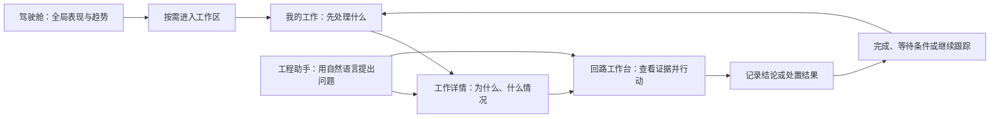

# CLPM 工程师任务导向 IA 改造方案

版本：v1.2｜日期：2026-10-11｜状态：**用户已采纳推荐，已纳入系统改造计划及评审；业务代码尚未实施本方案**

本轮裁决：“需纳入评审，按照你的推荐执行”；另明确全回路树选与指定单回路两种入口。执行包吸收正本为 [09-IA与工作台组件增补](/Users/zhangping/DEV/CLPM-MVP/docs/设计文档/系统改造优化-2026-10-10/09-工程师任务导向IA与工作台组件增补-2026-10-11.md)，已采纳内容不重复提请确认。

本方案承接前序 IA、工程师日常工作及自然语言智能体讨论。现状依据本轮静态源码盘点；主要基线为 `main@baa3f50d8d883356064d5774c07122ebb5f360eb`。没有将方案、源码存在或任务看板记录当作运行验收。

配套文件：[页面、迁移与验收清单](/Users/zhangping/DEV/CLPM-MVP/docs/设计文档/工程师任务导向IA改造-2026-10-11/01-页面迁移与验收.md)｜[入门学习笔记与自测](/Users/zhangping/DEV/CLPM-MVP/docs/设计文档/工程师任务导向IA改造-2026-10-11/02-学习笔记与自测.md)｜[装置性能优化方案](/Users/zhangping/DEV/CLPM-MVP/docs/设计文档/工程师任务导向IA改造-2026-10-11/04-装置性能核查与增强建议.md)。

## 1. 推荐方案与预期改变

**以“我的工作”作为工程师首页，以“回路工作台”作为处理具体回路的主场，以“工程助手”作为自然语言入口；驾驶舱负责全局观察，专业模块负责专项分析和批量治理。**

工程师的主路径改为：



这次改造要让工程师在同一条路径上回答五个问题：**处理什么、为什么轮到它、证据是否可靠、现在能做什么、怎样算完成。**

本轮交付方案吸收和组件设计评审材料，后续依已采纳方向及既有阶段前置执行。改造涉及导航、首页、个人关注、责任关系、上下文传递和智能体接口；算法算子、评分语义、DCS 人工实施边界仍沿用各自有效契约。

## 2. 现状判断：已有能力可以接成工作路径

| 当前能力 | 已有价值 | 需要改变的组织方式 |
|---|---|---|
| 驾驶舱六页签 | 展示全厂/装置/单元和各闭环环节概况 | 工程师首页增加个人工作视角；驾驶舱保留观察职责 |
| 工作台 `/loop/workbench360` | 单回路监视、评估、诊断、整定、处置 | 恢复明确名称“回路工作台”；从工作项携带对象和证据进入 |
| 自动关注队列 | 汇总预警、性能恶化、数据质量、适用性、处置异常 | 改称“系统建议”，说明原因；与个人责任清单分开 |
| 处置建议和工单 | 已有审核、排程、执行、验证和重开 | 在“我的工作”按稳定身份聚合，继续复用原业务状态 |
| 计算任务与通知 | 展示运行进度和计算结果 | 作为业务工作的关联信息；统一使用“计算任务”名称 |
| 专项概览和抽屉 | 诊断已复用 360；整定已复用四步组件 | 保留专业入口，减少初学者必须逐页寻找的步骤 |
| AI 洞察 | 固定场景解释、模型调用及模板回退基础 | 增加自然语言问题、多轮上下文、指定证据和受控工具接口 |

个人回路收藏在本次定向源码检索中未发现完整链路；现有页面偏好主要存于浏览器。既有 AI 注册的实际场景为 `performance/workbench`，不能据此认定已具备对话式智能体。以上均是静态判断，真实启用状态未在本轮验证。

现有“关注队列”主要回答哪些异常值得注意；正常的今日计划工单也必须进入个人工作清单，不能只查询异常。首页展示“分配给我”还需要打通用户 ID 与业务责任，姓名模糊查询不足以支撑该含义。

## 3. 目标信息架构

### 3.1 五组主导航

```text
我的工作                         工程师默认首页
  分配给我｜系统建议｜我的关注｜最近继续   页面内视图

工程助手                         自然语言问答与工作引导
  新对话｜历史对话｜当前证据             页面内区域

驾驶舱                           管理与全局观察
  总览｜回路｜性能｜诊断｜整定｜处置     保留现有六页签

专业作业                         按需展开，可固定常用入口
  回路工作台
  回路监控                       回路监视、预警事件、系统建议
  性能评估                       装置性能、指标分析、回路评估、计算任务
  回路诊断                       概览、记录、计算任务
  参数整定                       总览、记录、验证
  运维处置                       建议审核、待执行、执行与验证
  统计分析                       现有报表与分析页面

配置与管理                       按权限展示
  数据与台账                     工厂、链路、测点、回路、数据导入
  分析规则                       指标、诊断、预警规则
  系统管理                       基础信息、用户、审计、字典、权限、模块、报表订阅
  工程助手设置                   随助手批次新增，限获授权的配置人员
```

“专业作业”“配置与管理”首先是导航分组，不要求新增两个空白中转页。优先使用分组标题、折叠与页内标签，避免制造四五层菜单。原功能 URL 保持稳定；视觉导航层级不要求等同 URL 层级。

全局顶栏放回路搜索、通知和“计算任务”入口；个人菜单保留账号与偏好。新手直接走工作路径，熟练用户仍能搜索位号、固定常用专业页、批量操作。固定菜单只改变个人快捷入口，不改变权限或首页统计。

### 3.2 首页与角色

| 角色 | 推荐默认首页 | 工作范围和能力 |
|---|---|---|
| 仪控工程师 IC、工艺工程师 PE | 我的工作 | 按稳定责任关系组织工作；动作仍取有效权限 |
| 专家 EXPERT | 我的工作 | 可进入获授权的核查、诊断与整定；现行处置流转只读边界保留 |
| 管理观察者 SPONSOR | 驾驶舱 | 看范围内整体表现与证据；不出现可执行的认领/处置入口 |
| 管理员 ADMIN | 驾驶舱 | 保留配置职责；可在个人偏好中选择我的工作或获授权的常用页 |

“我能看到的装置”和“我负责的装置”分别保存和展示；尚未配置责任范围时明确提示，不能把全部授权回路默认算作个人责任。首期沿用现行五角色单角色账户；优先采用个人已保存且仍有权限的首页，否则按上表进入默认首页，不在 IA 中新增多角色账户能力。

专业作业中的“系统建议”保留当前用户授权范围内跨回路、跨装置的完整筛选；我的工作中的同名视图默认套用授权范围内的本人责任范围，复用同一查询规则。两处显示当前范围，不把不同范围下的数量强行对齐。

### 3.3 命名规则

“我的工作”始终指人的业务工作；“回路工作台”包含全回路选择和指定单回路两种入口，两者共用单回路作业组件；“计算任务”始终指系统计算。将“关注队列”改成“系统建议”，个人收藏使用“我的关注”。处置模块的“处置任务”显示为“待执行”，“处置工单”显示为“执行与验证”，同时保留工单编号和实体含义。

## 4. 我的工作：从工作清单开始

### 4.1 页面结构

```text
我的工作     [责任范围] [工作日期/时区]       [搜索回路] [问工程助手]
数据与工作清单截至时间；需要用户处理的服务缺失提示

[分配给我] [系统建议] [我的关注] [最近继续]

现在可行动                今日计划                  等待条件
需要我继续处理的事项      计划在今日处理的事项        等数据、工况、审核或观察期

事项｜回路/单元｜为什么处理｜当前证据｜负责人｜阶段/期限｜下一步
点击事项 → 工作详情侧栏 → 查看证据 / 进入作业 / 记录结论
```

日期用于计划和期限判断；**未完事项不按“今天更新过”筛选**，昨天产生且仍需处理的工作必须保留。业务日期和数据证据时间是两回事，界面分别标明。页面不给未知数据标上“实时”。

### 4.2 四个视图的含义

| 视图 | 收录规则 | 首要行动 |
|---|---|---|
| 分配给我 | 我负责的核查、明确分派给我的建议审核、已有工单执行/验证 | 继续核查、审核、执行、验证或处理阻塞 |
| 系统建议 | 责任范围内，或用户主动选择的授权范围内，系统发现的可核查事项 | 看原因与证据，认领或关联已有工作 |
| 我的关注 | 当前账号主动关注的回路 | 看变化、打开回路工作台、取消关注 |
| 最近继续 | 本人最近访问的工作、回路及分析上下文 | 从原位置继续；不自动变成待办 |

“分配给我”按互斥分区显示：先判断是否等待条件，其次判断是否今日计划，其余可行动工作进入“现在可行动”；今日计划中当前可操作的项目仍有操作按钮。未来计划和已结束项目通过筛选查询。统计不把同一事项重复累加。

已分派事项由既有业务责任字段确定。没有审核负责人或稳定处置人身份的历史记录，显示为“待确认责任”，不猜测归给某个同名用户。“系统建议”中的别人已认领事项显示负责人和关联工作，不鼓励重复认领。

### 4.3 每项工作应提供的信息

每项至少有：工作目标、回路/装置、来源、进入清单的理由、当前阶段、负责人、计划/期限、证据时间与充分性、等待条件、一个主要下一步。详情里再展开指标、历史、处理记录和相关建议/工单。

优先级来自有效业务规则，并显示“逾期”“重开”“高优先级预警”等理由；不由大模型生成一个不可解释的新评分。服务端统一排序和分页，同规则生成总数与明细。来源失败、条目截断、权限收缩都明确显示，不能用空数组伪装“没有工作”。

### 4.4 个人关注的最小范围

首版支持按账号关注/取消关注、跨设备保存、筛选关注回路，以及从列表、详情、工作台统一操作。数据关系为用户和稳定回路 ID；正常回路也可关注。取消关注不删除回路或业务工作，不解除已分派责任。

**数据库是个人关注的真相来源，浏览器只作缓存。**同时为需要跨设备的个人偏好、最近继续保存独立账户关系；清缓存、换电脑和重新登录不丢已保存内容。字段建议、服务端身份、唯一约束、并发/版本、权限失效、旧 localStorage 处理及验收见 [03-个人收藏与工作接续数据设计](/Users/zhangping/DEV/CLPM-MVP/docs/设计文档/工程师任务导向IA改造-2026-10-11/03-个人收藏与工作接续数据设计.md)。这部分属于 P6-05/06，当前尚未建表或执行迁移。

首版不引入关注分组、个人标签体系、团队共享收藏或通知规则编辑器。进入系统时展示关注回路的实际变化；主动推送策略另行设计，避免把收藏自动变成通知订阅。

### 4.5 空白、失败和首次使用

没有已分派工作时显示“暂无分配给你的工作”，并提供系统建议、关注与最近继续入口；不能写“所有回路正常”。责任范围未配置、范围内没有回路、尚无分析结果、数据源暂不可用分别展示。只给当前角色有权执行的配置或补数据入口；无权者看到需要谁接续处理。

新手默认先看原因、证据与下一步，专业指标和参数按需展开。对“数据不足”“等待验证”等关键状态提供简短解释和明确解除条件。重试仅刷新失败来源，尽量保留已读取内容、输入和清单位置。

## 5. 工作如何保存：一个入口，复用不同业务记录

### 5.1 业务对象职责

| 对象 | 它记录什么 | 本轮推荐 |
|---|---|---|
| 自动关注项 | 当前异常信号与原因 | 复用聚合规则；未认领时不承担个人业务责任 |
| 核查事项 | 尚未形成明确处置行动的问题、负责人和核查结论 | 新增最小业务载体；仅在认领、分派或主动创建时持久化 |
| 处置建议 `loop_action_item` | 明确的处置措施及审核 | 复用；补足需要进入个人清单的审核责任 |
| 处置工单 `handling_order` | 排程、人工执行、验证、关闭/重开 | 复用原实体及状态机，打通稳定负责人身份 |
| 计算任务 | 某次评估/诊断等计算的运行 | 复用；在相关工作旁显示进度和结果 |
| 助手对话与运行 | 问题交流、工具调用及解释 | 与业务工作分别保存，并用 ID 关联 |

已采纳小型独立核查载体，理由是当前 `loop_action_item` 已明确收敛为“处置建议＋审核”。即使允许手工建议没有诊断来源，它仍要求一项措施，不适合同时承接“先查清是否存在问题”。业务方向已经明确，具体表名、字段与迁移在契约阶段形成可复核设计，再按阶段实施。

“我的工作”是对这些业务记录的统一查询和展示，不再增加一个复制所有状态的万能任务表。

### 5.2 核查事项的最小设计

字段只包括：稳定 ID、回路、核查目标、来源证据引用、负责人、创建人、计划/期限、阶段、等待原因及复查条件、结论/证据、移交目标、责任与状态变更记录。先采用一名负责人，其他人可以提供意见；不引入子任务、复杂流程设计器或多层审批。

阶段为**待开始、核查中、等待条件、已结束**；结束结果分别记录无需进一步行动、核查目标已回答、已移交、取消。无需处置要有理由和证据，取消不表示回路正常。所需审核按有效业务规则执行。

核查可以产生处置建议并沿既有审核链进入工单，也可以关联已有工单。只有目标记录和接续责任实际建立后才能标记移交；原核查结束后显示回链，不跟着工单再次复制执行/验证状态。工单重开不自动重开原核查。

重复事件通过来源身份和问题关联去重；同一回路的阀门问题与采集缺口不能只因回路相同就合成一项。并发认领由服务端裁决，失败方看到实际负责人。责任移交记录旧/新负责人及时间，处理人变化不产生新的问题记录。

### 5.3 完成条件按工作类型确定

| 工作类型 | 可以完成的条件 |
|---|---|
| 异常核查 | 回答核查目标、留存结论与证据；确认无需处置也可以完成 |
| 数据问题定位 | 明确缺口、影响与后续责任；这只完成定位，不能称数据已修复 |
| 数据修复行动 | 有采集/导入等实际处理记录和数据恢复检查 |
| 建议审核 | 有有效审核决定和必要理由；接受建议不表示措施已实施 |
| 现场检维修/参数实施 | 沿既有人工执行与验证规则闭环；不以计算成功替代实施 |
| 移交 | 目标业务记录真实存在、关联和接续责任明确 |

## 6. 回路工作台：把证据和下一步放在一起

复用 `/loop/workbench360` 及现有剖面、诊断结果面板、整定四步流程，将其拆成宿主与可复用的单回路组件。

| 入口 | 对象选择 | 共用作业区域 |
|---|---|---|
| 全回路工作台 | 左侧装置—单元—回路树，按授权范围搜索和选取 | 右侧挂载选中回路的单回路组件 |
| 单回路工作台 | 直接传入回路 ID，隐藏全回路树和切换器 | 独立页或模块抽屉挂载同一组件 |

单回路组件包含趋势/事实公共区与评估、诊断、整定、处置四个剖面；其他模块可以指定初始剖面。组件接收回路、窗口、证据及业务工作上下文；宿主负责选择对象、页面导航和返回。详细调用协议、状态隔离、实时订阅及八项组件验收见 09 号文 §2–§6。

页面上部依次显示：**当前工作目标与回路 → 数据是否充分及截至时间 → 所选证据的结论 → 可执行的下一步**。趋势、专业指标、历史证据放在其后，深度参数按需展开。责任阶段、控制绩效、数据质量、是否适合整定分别表达，不能压成一个红黄绿健康灯。

全回路模式的左侧树可用于快速切换；从工作项进入单回路模式时锁定其回路。切换回路要显式退出原工作上下文或选择新工作，不能把 A 回路的任务带到 B 回路执行。全模式未指定对象时展示选择器、关注和最近记录；单模式缺少对象或指定不存在/无权 ID 时明确提示，禁止自动换成第一条回路。

| 证据支持的判断 | 推荐下一步 | 条件不足时 |
|---|---|---|
| 数据不足/质量异常 | 检查采集、补齐数据、查看正式不足结论 | 显示缺口及影响，不判正常 |
| 阀门/仪表问题 | 进入检维修核查或已有处置记录 | 保留候选原因并列明待核实证据 |
| 工况变化 | 选择可比窗口、进行工艺分析 | 等待合适工况或标记不可比较 |
| 参数相关且满足条件 | 进入既有辨识、整定、仿真流程 | 解释门禁和补证据步骤 |
| 已人工实施 | 打开对应方案、实施记录与效果验证 | 未到观察期则进入等待条件 |

下一步由可追溯的业务规则和有效结果决定；AI 可以解释。不能沿用“只要存在异常且没有整定记录就推荐整定”的通用捷径。可整定性表示允许尝试，不表示该回路现在值得整定。

## 7. 驾驶舱与专业页的职责

驾驶舱保留六页签及舱内只读下钻，回答“全局表现、问题分布、治理进展”。不在各卡片里增加大量编辑按钮。按本轮已采纳裁决，将现有“管理后台”唯一出口改称“进入工作区”，工程师进入我的工作，观察角色进入获授权的只读专业页。

统计下钻继续对账，不自动把全厂统计翻译成个人待办。管理者发现问题后，先查看范围和证据；实际分派由具有相应权限的人在工作区完成。

专业概览负责跨回路比较、批量分析、查记录和专项规则；单回路深度作业继续复用 360 或既有抽屉。批量操作要逐项列出可执行、条件不满足、无权限和失败结果。报表订阅仍受当前真实能力和模块状态约束，菜单迁移不宣称修复订阅执行链。

### 7.1 装置控制回路性能分析（已采纳）

增强既有 `/metric/pid-dashboard`，保留“专业作业 → 性能评估 → 装置性能”入口。驾驶舱提供装置摘要与只读解释，装置性能页负责集中分析，绩效报告负责周期汇总和导出，不新增重复看板或一级菜单。

主路径为“装置＋精确时间 → 综合评分/自控率/平稳率 → 趋势 → 单元对比 → 问题回路 → 回路工作台”。更多指标按需展开；首屏常驻完整 P 可评分比例 N/E、未评分原因和数据截至。F 参考统计及不足提示按执行包 10 号文独立表达，不进入正式 P；页面精简不隐藏必要证据。

驾驶舱的同一“进入工作区”出口在选中装置时提供显式“分析当前装置”动作，携带原范围与窗口；默认点击保持本节原有工作区落点，工程师进入我的工作、观察角色进入获授权的只读专业页。工作区落点与登录默认首页不同，不能把观察者再次送回驾驶舱。排名普通点击保持舱内解释，不因选择装置自动离舱或改变用户首页。

修复装置排名下钻到全厂、指标跳转丢装置/近似窗口等接续问题；来源页、目标页、返回页均消费并回显范围、精确起止、指标、证据及有效筛选。数字对账以同口径为前提；最新快照与期间统计分别标明。沿用已有聚合与权限契约，不重新定义算法或扩展装置经济绩效。

详细正文、任务与 PL-01–06 验收正本见配套[装置性能优化方案](/Users/zhangping/DEV/CLPM-MVP/docs/设计文档/工程师任务导向IA改造-2026-10-11/04-装置性能核查与增强建议.md)，纳入 P6-01/02/03/04 和 P7-02，承接 P1/P3 成果；不改变实施前置。

## 8. 工程助手：独立入口、共享事实与工作

### 8.1 页面和首版范围

推荐独立“工程助手”页，并在工作项和回路工作台提供“就此询问”入口，打开同一助手的上下文面板。独立页和面板共享对话记录，不维护两套聊天系统。

界面包含对话、已选对象/范围/时间、证据卡、下一步动作。常用问题入口包括“今天先处理什么”“我关注的回路有哪些变化”“这个结论是什么意思”“为什么目前不能整定”“怎样验证已实施方案”。

首版回答已接入事实范围内的问题，支持查工作、查回路事实、查指定记录、解释条件、进入专业页。后续再开放受控计算和业务写入。用户仍可完全通过页面完成工作。

助手批次补充“配置与管理／工程助手设置”：复用既有模型配置服务，提供启用状态、可用能力与连接检查；凭据按现有安全配置机制管理。当前前端 LLM 配置入口已退役，不能把后端端点存在当成用户已经能够自助配置。未配置时解释原因并提供获授权人员可用的配置入口。

### 8.2 一个完整对话路径

用户问“这个回路波动，应该调参数吗？”→助手确认回路和窗口→读取质量、评估、诊断及相关记录→说明哪些是事实、哪些是候选原因、还缺什么→给出“查看指定诊断证据”“进入检维修核查”或“进入整定条件检查”等适用按钮。

按钮携带本次证据和工作身份。用户进入页面完成操作后，可回原工作或对话，显示实际新增记录和阶段变化。示例是交互设计，未假设任何回路已经发生真实异常。

### 8.3 算子确定，调用受控

自然语言 → 结构化目标与上下文 → 服务端检查权限/条件 → 调用已有确定性服务或算子 → 返回带身份和版本的结果 → AI 组织解释与动作。

模型不直接生成业务评分、诊断命中、PID 建议数值或验证有效结论；这些结论必须来自指定算子结果。规则、单位和阈值来自有效配置。现有 AI 的模型适配能力可复用，但固定场景的“取最新记录/默认全厂窗口”需要改为明确的上下文契约后才能使用。

| 工具能力（逻辑名称，非现成 API） | 首版 | 约束 |
|---|---|---|
| 查询我的工作/关注/系统建议 | 接入 | 使用与页面相同的身份、范围、排序和完整性信息 |
| 读取回路事实与指定证据 | 接入 | 返回时间、记录 ID、版本、适用条件与缺失原因 |
| 生成页面动作 | 接入 | 系统从允许的路由生成按钮并校验参数，模型不自由拼 URL |
| 发起评估/诊断/整定计算 | 后续 | 展示对象、窗口、方法、成本和影响；沿现有门禁执行 |
| 创建核查、分派、转换建议/工单 | 后续 | 先预览具体变更，得到用户明确动作授权；请求可安全重试 |

每次运行保留工具调用、源结果、失败/取消信息；重试不重复创建业务对象。模型不可用时明确提示，模板解释标记来源，专业功能继续可用。平台不直接向 DCS 写入参数。

### 8.4 与现行两仓分工衔接

按项目现行约定，CLPM-MVP 负责本体业务功能，iCLPM/iCLPMagent 负责智能体协同层。推荐 CLPM 提供工作入口、专业页面、业务对象、权限校验和确定性工具接口；对话编排与智能体运行能力接入 iCLPMagent。工程师在产品里保持连续体验，不需要理解两个代码仓库。

IAR-0/IAR-1 需明确集成协议和各侧责任：用户身份与范围如何传递、证据如何引用、会话和运行保存在哪里、界面由哪侧提供。现有 CLPM AI 洞察可复用的适配能力据此评估，不默认在本仓再造第二套智能体平台。本轮未检查 iCLPMagent 的当前实现，也未对另一仓派发任务或迁移代码。

## 9. 跨页面上下文契约

从清单、统计、助手或报告进入作业，至少传递：回路 ID、装置范围、证据起止时间与时区、所选记录 ID、适用的配置/模型版本、核查/建议/工单/方案身份、来源及返回位置。

目标页消费并回显全部有效条件；不支持的条件明确提示。历史证据与当前事实分别显示；不能拿“最新记录”替换用户指定记录。清除筛选也要显式更新上下文。返回清单保留筛选、页码/游标和位置，并刷新真实业务变化。

页面链接只负责定位，不授予权限。提交或运行前服务端再次核对权限、证据版本、工作状态和条件；过期页面应提示变化。缺失或已删除的记录显示不可用，不回落到任意另一条记录。

## 10. 改造批次与现有计划衔接

本方案使用 `IAR` 编号，避免与现有 P0–P7 和问题台账编号混淆。下面是推荐依赖顺序，不是已派发任务或工期承诺。

| 批次 | 交付内容 | 进入下一批的条件 |
|---|---|---|
| IAR-0 设计冻结 | 确认导航、首页、命名、核查语义；用空字段结构稿走查关键路径 | 关键设计决定明确；原裁决差异已登记 |
| IAR-1 工作与上下文基础 | 稳定负责人、责任范围、关注关系、核查载体、统一查询及上下文协议 | 身份、去重、并发、完整性、权限和证据契约可验 |
| IAR-2 工程师工作入口 | 我的工作、关注、工作详情、360 下一步、导航及兼容入口 | 完成人的工作路径；此批可形成不依赖 AI 的首个完整交付 |
| IAR-3 助手查询与导航 | 独立对话、上下文面板、证据卡、页面动作与运行记录 | 页面和助手对同一问题给出同一事实，能往返接续 |
| IAR-4 受控行动扩展 | 按价值逐项接计算发起、核查/分派等工具 | 每项工具各自通过权限、门禁、预算、幂等和失败恢复验证 |
| IAR-5 综合验收 | 真实岗位任务、旧路径、权限、容量、失败状态与操作手册 | 固定候选的独立证据完整，再按授权进入交付 |

现有 P2 提供配置与证据身份，P3 提供结论和人工实施/验证语义，P4 提供权限与装置范围，P5 提供分页/聚合与容量。IAR-2 中既有 P6 工作仍遵守 G3/G4/G5 前置；不因新增 IA 就提前宣称这些依赖完成。

本方案已根据本轮用户裁决更新 P6/DEC-07 的目标结构，由 09 号文吸收，新增 P6-05/06/07，P6-02 增加双入口和组件拆分。共享入口仍指定单一实施负责人。当前在途 P2 工作继续按原范围推进，本轮没有修改其迁移或执行环境。

交付顺序优先保证 IAR-1/2 的完整工作路径，再接 IAR-3。只读助手可以并行设计契约，但不能用聊天界面替代未完成的责任关系与业务结果记录。

## 11. 已采纳的推荐与新增工作台裁决

| 决策编号 | 本方案推荐 | 主要影响 |
|---|---|---|
| IAR-D1 | 采用五组导航，专业能力按需展开 | 改变十项并列导航；功能 URL 与业务权限继续保留 |
| IAR-D2 | 工程师首页改为我的工作；观察者与管理员默认驾驶舱 | 更新全角色驾驶舱首页裁决；单角色首页及个人偏好规则见 §3.2 |
| IAR-D3 | “工作台”改称回路工作台；“关注队列”改称系统建议 | 建立工作、对象、计算的清楚命名；操作手册与通知同步 |
| IAR-D4 | 增加账号级关注和最小核查载体，复用建议/工单 | 新增持久化业务能力；需单独冻结数据与迁移契约 |
| IAR-D5 | 独立工程助手，首版查询、解释和导航 | 新增对话和工具协作；后续受控计算/写入按工具分批 |
| IAR-D6 | 驾驶舱唯一出口改称进入工作区，并按角色落地 | 调整入口名称和目的地；保持舱内只读观察职责 |
| IAR-D7 | 全回路树选、指定单回路两入口，共用单回路组件 | 本轮用户明确使用方式；新增组件和宿主契约及专项验收 |
| IAR-D8 | 增强既有装置性能页，三项核心指标、可信度说明、装置到回路的连续分析路径 | 用户已明确同意纳入；驾驶舱/分析页/报告分工，沿用 P1/P3 统计契约及 P6/P7 任务 |

IAR-D1–D6 已由用户“按照你的推荐执行”采纳，IAR-D7 来自同轮补充要求；IAR-D8 来自用户同意把装置相关优化整理进方案，均进入设计评审和阶段实施计划。业务代码、菜单和数据库没有因为文档吸收而自动完成改造。

## 12. 设计的成功判据

工程师能够从首页说明自己接下来处理哪项、为什么处理、证据截至何时，并到达正确的作业位置；完成后能找到业务结果。等待条件不占据“现在需要行动”的清单；收藏不产生责任；数据缺失不表示正常；计算完成不表示现场闭环。

测量找到工作耗时、完成率、错误路径、求助次数与上下文丢失。候选体验目标为“从首页选中工作后不超过两次界面进入即可到正确作业位置”；这只是拟定目标，需先测当前基线，再与真实岗位参与者确定正式标准。必要的证据审查不为了减少点击而省略。

所有涉及错回路、错窗口、错方案、越权、虚假健康和错误闭环的反例必须通过。浏览器检查或 AI 代理走查不替代真实岗位验收。详细清单见配套文件。
