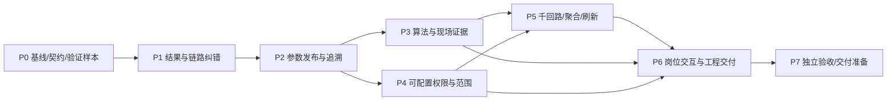

# 阶段任务计划

编制基线：`20eb321b94292ca46e36c1d16c195da7e81577d0`；编制时任务未启动，**当前状态以执行状态目录的 Gate/交接正本为准**。2026-10-11已吸收07辨识、09 IA、10评估专项，主任务现为 **41项**；本次新增P3-08/09/10未启动，保留G2前置。完整路径相对仓库根目录；简写按下表展开后定位，执行者先解析自己的CLPM_ROOT，不能改其他仓库。

| 路径简写 | 唯一展开前缀 |
|---|---|
| services/、models/、schemas/、contracts/、tasks/、api/ | backend/app/ |
| endpoints/ | backend/app/api/v1/ |
| metric_calculator/、diagnosis_operators/、tuning_identification/、preprocessing/ | backend/app/services/ |
| 无目录的后端服务文件如loop_fitness.py/diagnosis_orchestrator.py | backend/app/services/ |
| 无目录的main.py | backend/app/ |
| views/、router/、composables/、components/ | frontend/apps/web-antd/src/ |
| cockpit/ | frontend/apps/web-antd/src/views/ |
| use-tuning-workbench.ts | frontend/apps/web-antd/src/views/tuning/composables/ |
| use-latest-request.ts、use-clpm-roles | frontend/apps/web-antd/src/composables/ |
| tests/（后端语境）、scripts/（后端语境） | backend/ |

已含backend/frontend/db/docs/e2e/scripts完整根前缀的路径不再次展开；新模型/迁移/服务由对应任务显式列为新增，P0冻结精确文件名。独立符号或通配路径先查相邻代码，不据简写创建重复文件。

2026-10-11 三方案交叉复核已吸收：接收快照、P2补欠、共享Owner与INT联合验收见[11号文](11-三方案交叉复核与融入计划-2026-10-11.md)，当前接续使用[12号提示词](12-zcode接续交接提示词-2026-10-11.md)。本次修订不改变原P2/G2后暂停点，不启动P3。

## 1. 依赖与执行组织

顺序理由：先确定独立预期和对象/窗口契约，避免测试自证；P1先保护结果身份，再修数值；P2固定参数与输入版本；再修模型与现场闭环；授权范围稳定后才确定聚合缓存键与分页；最后用岗位任务验证交互。P3/P4可以在独立worktree并行，跨共享文件由主协调串行整合。P1局部依赖为P1-05→P1-01/02/03；P1-04可独立并行，G1等待五任务全部完成。

主协调维护候选基线、路径Owner、环境keeper和验收状态；每个任务只有一个实施者。评审者不参与该任务编写。实施阶段完成报告至少含固定SHA或未提交diff摘要、命令真实退出码、测试分母、skip/xfail、文件/符号、缺口、下一步；自验不能改名为非作者验收。

## 2. 总览与工作量

工作量为实施+作者测试的人日规划区间，非实测工期、不按模型速度承诺。每任务卡内部再拆≤半日至1日的可验证步骤；复杂任务先交字段/API契约再实施。

| 阶段 | 必要前置 | 交付目标 | 预计人日 | 晋级要求 |
|---|---|---|---:|---|
| P0 | 用户启动本阶段 | 当前事实、路径授权、标准profile、结果/输入身份、验收样本/环境/预算冻结 | 2–3 | G0，DEC-01/02/05/08/09/10落定 |
| P1 | P0 | 追加结果账本先行；错分/错聚合/错入口/假空态纠正 | 6–9 | G1，双版本身份、数值反例和五角色链通过 |
| P2 | P1 | 参数单源、发布一致、不可变输入/构建、可复核与工程模板 | 7–11 | G2，API/真实Worker子进程链与复现通过 |
| P3 | P2 | 评估/诊断/辨识/仿真科学契约、完整可评分比例/F参考统计及人工实施证据 | 专项合并后去重重估，原7–10不覆盖增补 | G3，独立参考、统计/最小读端兼容和现场链通过 |
| P4 | P1/P2 | 五角色页面/操作可配置、装置范围与撤权栅栏 | 6–10 | G4，HTTP/WS/运行中提交全负例 |
| P5 | P2/P3/P4 | 数值等价的热点优化、真实1000回路容量和聚合交互 | 5–8 | G5，固定环境与持久化分母达标 |
| P6 | P3/P4/P5 | 四类岗位任务、个人工作、双入口/单回路组件、助手查询导航和批量配置 | 09 增补后待契约冻结重估，原 4–6 不覆盖新增范围 | G6，IAR-A01–A28（A18b 随 IAR-4）、岗位走查和双主题证据齐全 |
| P7 | P0–P6 | 独立综合验收、行业校准、迁移/交付准备 | 3–5+现场样本周期 | G7；现场数据未备齐不得宣称行业验收通过 |

推荐最短可信交付为P0–P3，不因P4/P5未完成而扩大只读角色权限或对外承诺千回路产能；完整产品优化必须走到P7。首批止血可在P1卡内逐项交付，不能跳过前置契约。

用户已接受10评估专项增量并纳入P3—P7。原估算18～28工程人日、独立复核另2～4人日是排程量级；与诊断/辨识共享工作去重，增加08d统计与读端、取消线上影子后再按子卡重估，现场样本等待另计。不把“直接采用新算法”解释为取消验收或自动部署。

## 3. P0 基线、契约与独立预期

Owner：主协调+算法验证者；本阶段业务代码只读。允许新增本执行包下的冻结契约/案例/基线记录。

### P0-01 当前基线与修改范围

- 输入：AGENTS.md现行MVP、stale-docs、本包台账、当前路由/注册API/代码与git差异。
- 工作：核每条台账活链；标已修复/不复现；输出任务→文件Owner表与旧页面逐路径授权清单；核运行环境和Worker/Beat唯一归属。
- 输出：baseline manifest、范围差异、DEC-01记录。禁止变更AGENTS、启动服务、切换共享分支或清理既有目录。
- 验收：每个发现有有效任务/保留理由；SHA与文档一致；待修改旧页面未经授权不能进入后续实施。

### P0-02 数值和工业语义冻结

- 落点：`services/metric_calculator/{accuracy,fast_rate,stability,effective_auto}.py`、`confidence_evaluator.py`、`diagnosis_operators/*`、`tuning_algorithms.py`、GB/T44693.2原文、`tests/compliance/*`。
- 工作：冻结产品/标准参考profile、等级、聚合分母、窗口、数据前提、模型单位、诊断结果及支持度术语；冻结01§3.1追加结果账本/投影/历史ID/节点input recordIds契约，01§3.2不可变输入包与旧构建保留、存储预算；确认DEC-02/06/09/10。动态算子逐项登记频带、抗混叠前提、最大gap、最短有效段、多段归并与不足拒绝规则。
- 验收：标准正文/资料性附录/产品差异分别登记；每个核心公式至少一个独立手算或独立参考；结果唯一键/兼容迁移/复现读取/保留责任有字段级契约；不以现有实现生成期望值再验证自己。标准原文不可提取时按页人工核或取合规副本，不凭旧报告补写已确认符合。

### P0-03 测试、容量和岗位场景基线

- 落点：既有golden/compliance/integration、`backend/scripts/{benchmark_kpi_optimization,kpi_capacity_benchmark,perf_test_attention_summary}.py`、`e2e/tests/*`。
- 工作：建立《04》场景manifest与测试命令表；指定1000独立回路数据、硬件、窗口、冷/热缓存、并发和负载；标准小时/custom/诊断分别冻结入口、参评资格、完整指标profile和持久化完成屏障；冻结C11合法进程拓扑及PID取证；确认DEC-05/08。既有bench仅查读，本阶段不执行。
- 验收G0：测试样本、独立预期、拟运行命令、写入目标、清理策略与环境Owner明确；历史证据不能冒充当前基线结果；所有待裁决项有具体负责人与阻断阶段。

## 4. P1 现有结果与链路纠错

前置：G0。Owner：评估/聚合/前端/既有授权实施者，拆独立worktree；共享文件串行。

### P1-05 结果账本与兼容投影前置

- 文件：`backend/app/models/{metric,node_kpi}.py`、`backend/app/tasks/kpi_calc.py`、`backend/app/services/node_performance.py`、历史详情schema/API；新增`calculation_result_record`模型/迁移/服务及`db/postgresql`引导SQL。
- 工作：按P0字段契约先归档现有结果并映射旧ID，再实现完成结果追加、sourceRecordId重评关系、节点输入recordIds、事务切换当前投影；历史可按不可变recordId读取；保留原表唯一约束和兼容读。历史未知算法/输入显式LEGACY_UNVERIFIABLE。
- 验收：C12a：同loop/同窗v1/v2按不同recordId共存；旧recordId、工单引用与payload不变；同logicalRunId重试幂等；历史迟到不改变当前业务窗；节点追到实际输入版本；新装/升级迁移均核schema。
- 前置保护：本任务完成并独立验收前，P1-01/02/03不得启用新算法写入或同窗回算；P1-04可并行。P1阶段未保留原输入的记录不能承诺完整复现，P2-03补齐新计算输入包。

### P1-01 评估边界与缺失语义

- 文件：`backend/app/services/confidence_evaluator.py`、`services/metric_calculator/{stability,effective_auto,fast_rate,settling_time}.py`、`services/preprocessing/{quality_summary,input_guards}.py`、`contracts/data_types.py`、`services/data_planner.py`、`db/postgresql/02_seed_data.sql`及对应契约注册迁移。
- 工作：零权重不读取缺key；冻结看信号自身而非仅error方差；有效自控明确PV/SP缺失状态并补契约；缺失摘要一致；修非默认容差的快速率跳变，保持P0选定profile。
- 验收：CAL-01/02/03/08及STD-02反例；输入不足显式不可评，不放宽可信度；现有正常样本回归差异经独立解释。
- 回退：保留旧algorithmVersion结果，不覆盖历史；应用回退只恢复旧profile入口，不删新证据。

### P1-02 节点与总览统计口径

- 文件：`backend/app/services/{node_performance,workbench_assessment,workbench_precalc}.py`、`backend/app/tasks/kpi_calc.py`、对应schema。
- 工作：每指标有效分母/null、半开窗、历史级联传原窗、应评台账分母、上一等长窗环比；无评估null状态；scope查询取每节点最新行。
- 验收：100/NULL等权结果100且覆盖率1/2；两有效值100/0结果50；全缺null；窗口边界仅归一窗；历史任务不刷新无关当前窗；最新节点行不重复；总览/明细同窗对账。
- 约束：不把不可评按0；不静默排除缺评；重算另存版本与原因。

### P1-03 只读入口与显示事实

- 文件：`views/cockpit/wb-comps/use-drill.ts`、`views/cockpit/components/modals/list-modal.vue`、`views/loop/workbench360/{index.vue,composables/use-assess-history.ts,composables/use-journey-summary.ts}`、`views/monitor/attention.vue`、`views/handling/components/handling-archive-drawer.vue`、`api/v1/endpoints/performance.py`、报告生成入口。
- 工作：分页/总数/数值排序；错误与空态分开；最新标准评估独立查询并按DEC-09处理迟到窗口；适用性权威接线；VERIFYING和在途集合统一；评估角标与列表同范围；归档查全；报表无真实文件不得完成。
- 验收：IA-01/02/03/04/06/08/11/12（2026-10-11 验收勘误：原行误含 IA-10——台账 IA-10 任务列本为 P2-03/P6-02，以其为准；补漏记的 IA-03/11）；history翻页/过滤不改变当前评估；1000记录可查全；422/500不显示暂无数据；报告占位API明确拒绝或未开放。
- 约束：舱内下钻仍只读；不恢复旧工作台/旧诊断；不把limit200简单改100后暗示全量。

### P1-04 既有五角色与组态止血

- 文件：`services/auth.py`、`api/deps.py`、`endpoints/{tuning,tasks,loops}.py`、`router/routes/modules/reports.ts`、`views/task/list.vue`、`views/loop/manage/LoopEditDrawer.vue`、相关权限测试。
- 工作：五角色整定读取与最新裁决一致；PE提交→轮询→结果完整；取消/删除/批量删除分别匹配当前API；EXPERT父路由可达；组态保存失败不推进；高级参数字段守卫和密码重置令牌撤销按现有策略收口。
- 验收：五角色×读/发起/取消/删除矩阵；SPONSOR只读；IC不因`loop:*`获得ADMIN专属删除；高级参数直接POST也受限；保存失败留输入，持久化成功后才完成；重置后旧令牌拒绝。
- 晋级G1：P1五任务所有对应案例（含C12a）与相关门禁通过，非作者核真实读写链及旧证据不变；未扩大授权或改变未裁决路由。

## 5. P2 工程参数、发布和结果追溯

前置：G1与DEC-03。Owner：配置后端；前端UI在API冻结后接入。

### P2-01 单源参数目录与统一校验

- 文件：`services/algorithm_config.py`、`services/performance.py`、`endpoints/{algorithm_config,configs}.py`、`schemas/tuning.py`、`services/tuning_algorithms.py`、`views/metric/algorithm-params.vue`、`views/diagnosis/config.vue`。
- 工作：远端注册key为全集；移除废弃键/补新键；bool/int/float/enum/finite、值域及组合约束；整定按方法注册表校验参数；所有写入通道共用校验；诊断方法说明与真实可调字段分开。
- 验收：新注册键无需再维护第二份列表；旧键拒绝且明确迁移提示；0.5点数、NaN/Inf、数值布尔、未知键、颠倒档位、非法controllerType拒绝；返回有效参数与实际计算一致，禁止静默兜底改写业务值。

### P2-02 分层配置发布与跨进程一致

- 文件：`algorithm_parameter/sys_config`既有模型、配置版本服务、`tasks/celery_app.py`、`main.py`、`backend/app/api/v1/endpoints/confidence_config.py`参考机制；新增统一配置发布服务/版本覆盖模型及Alembic迁移。
- 工作：接统一层级；记录有效值/来源/遮盖关系；expectedRevision冲突保护；原子发布revision与审计；任务启动读有效revision，广播通知；失联显式失败或使用已固定任务快照，不能用过期参数启动新计算。
- 验收：按C11一个API+唯一lifespan Worker master内至少两个真实prefork子PID，v1→v2无重启新任务均用v2、运行中任务仍v1；同时更新一方409；Redis断连后版本校验仍可靠；恢复默认能解释更高层覆盖。Windows solo按重启/持久版本验证单独报告，不能称跨子进程通过。
- 约束：不创建模块级asyncio同步原语；不能只用pub/sub代替持久版本检查。

### P2-03 计算上下文与历史复现

- 文件：`contracts/data_types.py`、`models/{metric,tuning,diagnosis_run}.py`、P1结果账本、`tasks/kpi_calc.py`、`services/{tuning,diagnosis_orchestrator,process_model_version}.py`、整定保存schema/composable；新增输入快照元数据模型/迁移及本地输入包存取/校验/保留服务。
- 工作：按01§3.2保存CalculationContext及不可变NPZ+JSON包，区分binding datasetRef与inputHash；时间轴/值/质量/mask/单位/量程/解释版本完整；保存受控执行构建digest及旧版本读取配方；原子文件与DB引用、保留/损坏拒绝/固定引用；最终方案关联sourceRecordId/process_model_version_id，冻结参数、仿真输入、窗口、DCS模板。显式重评追加，不覆盖方案；在线TDengine provider与数据不足规则保持。
- 验收C12b：v1结果→源数据迟到/覆写/质量改变及配置v2→仍读原包按旧构建复现v1一致；按v2重评保存实际输入身份及独立结果；包损坏/过期/缺旧构建拒绝完整复现；相同绑定不同数值hash不同；历史缺字段明确；固定引用包不能被GC；最终方案保留来源与已有fitness快照。
- **2026-10-11 EA增量复核：** 原Owner在G2前用10号文C12-EA1/2补核真实旧参数/旧构建执行，确认缺口即修；digest保留清单不能代替执行旧构建，当前缓存参数不能冒充旧参数。不重写原PASS报告，追加受影响范围的复核/修复证据；当时P2-04继续，最新接收状态见下卡及11号文。P3-08a接收成果并补新profile能力，不能把原C12b承诺全部后移。

### P2-04 工程模板、阈值真实消费与维护界面

- 文件：`loop_config.py`、`loop_fitness.py`、既有回路/量程/MODE/DCS配置页及配置API。
- 工作：模板版本按响应/控制特征组织；饱和/偏差counter直接接有效阈值；预览覆盖和受影响回路；批量配置有dry-run、差异、部分失败状态；读取与发布能力分开。
- 验收：带宽2%→4%按样本重计且饱和占比不下降；偏差阈值扩大命中不增加；全局/模板/节点/回路/task优先级逐层可查；模板升级不自动改固定历史版本；1000回路批量操作可追溯。
- 本轮责任修订：交付前P2-04模板修复/非作者复验已PASS、原G2已登记；接收成果后由原P2-03 Owner串行整合共享快照文件，补完整有效参数固定/双构建真实复现。已有基础复用，不重开P2-01/02。A容限/T′的新增语义来源/单位/解释版本及消费交P3-08a/09a与P3-03；P2只交事实载体和已知/未知表，DEFAULT_0_100不当已核实限位。
- 范围移交须留未完项：维护UI（模板预览/发布/dry-run/差异/失败项）归P6-04；1000回路后端容量归P5-05，端到端维护归P6-04/G6。G2验后端真实正确性，不能把转移项登记为已完成；W4最终方案保存丢来源已在14dbca55静态确认，需修savePlan/API/schema/create_tuning_task全链并服务端校验冻结；异步整定记录已有来源不等于最终选定方案已保存。此项仍属G2增量，不随UI后移。
- 晋级G2：真实配置保存→发布→跨进程实际KPI任务消费→结果快照、原C12b旧参数/双构建复现、P2-04发布复验、schema迁移及1.1/1.2兼容通过；固定接收SHA与字段缺口/后续Owner清单。缺构建拒绝只是负例，不替代可用旧构建成功复现；原G2历史PASS不覆盖本次欠项，追加增量报告后才能作为P3接收前置。

## 6. P3 诊断、整定与人工现场证据

前置：G2。Owner：诊断/整定/处置分工，单位/模型schema共享处串行。**（2026-10-11 依 07 号文增补：新增 P3-06 被动历史过程辨识与 P3-07 模型到鲁棒 PID 整定；共享 tuning.py/pipeline.py/tuning_algorithms.py/schemas/models 指定唯一整合 Owner，独立算法模块可分工、共享入口串行写。P3 内部依赖序：P3-03 单位基础+P3-06a 正确性 → P3-06b 片段利用 → P3-06c 闭环估计/跨事件验证 → P3-03 连续模型终验+P3-04 正确反馈仿真 → P3-07 支持结构的鲁棒整定 → G3。）**

三方案公共前置：G2后先D0＋P3-08a冻结字段/时间/质量/状态及共享纯算子接口；08b/c交基础，D1/2按同接口接线，D3/4→D5；09/10分别消费固定接口。粘滞/仪表由P3-01供给10/09a，不以10全完成反过来阻断01，也不在运行中互调整套诊断/KPI。08d＋09a与D6先完成最低reader再启新writer。唯一Owner串行表、12组消费者候选见11§4/5，算法正文与07依赖保持。

**2026-10-12 G3纠偏纳入：** [14号文](14-G3纠偏任务与执行提示词-2026-10-12.md)定义G3-R01/02/03（08d/09a/D6内部）、G3-APP（06/03/07接收）及G3-STATE（主协调）。P3-07继续；真实API语义传输、最新不挑旧成功、错误不冒充空态、适用性/集合资格及看板同步须在G3前闭合，预留代码/仅mock不作完成；主任务仍41，既有算法裁决不自动更改。

### P3-01 诊断数据、阈值与结论有效性

- 文件：`diagnosis_orchestrator.py`、`diagnosis_threshold.py`、`diagnosis_operators/{gate,classification,stiction,oscillation,disturbance}.py`、`metric_calculator/stiction.py`、现行diagnosis_v2 schema。**（2026-10-11 P2-03 验收建议增补：显式接 `diagnosis_run.dataset_snapshot_id` 写入方——P2-03 已备好列与 KIND_DIAGNOSIS_RAW 服务支持，本任务接线防两不管。）**
- 工作：真实recommendations按diagCode消费；连续有效段与mask同步；actual range/normalized signals统一；零有效检查/全部异常/有效阴性分开；外扰排除SP变化、0%手动边界；多阶跃响应截到下一SP变化，expectedτ消费工程来源；同源证据依赖显式登记；保存覆盖、支持度及参数。
- 验收：DIA-01–08与CFG-02；阈值变化反例实际改变算子；断点不造频谱；改变工程单位/量程不改归一化结论；全部skip不输出健康；内核异常可见；0%自控不漏判；SP阶跃不被无证据称独立外扰；多阶跃不混拟合，响应未完成有不足原因；支持度不冒称概率。
- 08专项内部子卡：D0契约→D1连续输入/真实参数/诊断落包＋D2状态/持久化→D3振荡粘滞＋D4响应异常→D5融合建议（与P3-02接）→D6最低消费者；D6可从D2先行准备，reader须在writer前。D子卡不另计主任务，27项-D案例按04分Gate验。
- D6与评估08d的范围含API类型、共享面板、360/cockpit、评估现役页、报告/导出、monitor_attention与现役AI洞察。后台规则不能用旧confidence=E推断数据坏或score=null推断良好，不能由参考F直接建议改PID。12组路径/授权候选见11§5；已批准08-B八文件只做限定适配，不改导航/布局。
- 约束：L0手动警告放行正式DATA_INSUFFICIENT规则保留；不恢复旧诊断router；旧recall不当v2验收。诊断采用08§10.2发布/回退条件，不套用评估EA-D05取消受控范围的口径。

### P3-02 自动任务ID、幂等与恢复

- 文件：`backend/app/tasks/{diagnosis_schedule,diagnosis_v2}.py`、`backend/app/services/alert_rule_engine/dispatcher.py`、`services/task_tracker.py`、`models/diagnosis_run.py`、`services/diagnosis_system_actions.py`。
- 工作：统一使用create_task返回ID；批次/checkpoint键和唯一约束；同事件/窗口重试不重复已完成run/建议；取消检查与进度真实；人工/SYSTEM身份分别记录。
- 验收：中途失败重试，run/建议/任务三方一一对应；手动/定时/事件入口都可跟踪；取消后不发布后续结果；按08§4.2以取消→运行失败→不可判定→可判定互斥统计对象终结，排队/运行另报，PARTIAL及selected算子覆盖独立记录，不重复计取消。诊断运行、科学结论、KPI的E六类及人工工作完成不能共用一个“成功数”；INT-03混合批次对账。

### P3-03 单位、辨识原点与独立模型终验

- 文件：`pid_conversion.py`、`dcs_config.py`、`loop.py`、`tuning.py`、`tuning_algorithms.py`、`tuning_identification/pipeline.py`、`use-tuning-workbench.ts`。
- 工作：DCS⇄标准PID贯通；历史/STEP统一K单位；AREA/IPDT只处理真实阶跃后响应；独立终验连续模型；显式区分最佳解释模型与可整定模型。
- 验收：PB/增益、秒/分钟双向往返；量程改单位后的等价标准PID；前基线5/20分钟不改θ；AREA/IPDT与独立响应参考一致；最后20%实际参与评价，训练好但终验差不提升可信度；SOPDT/FOPDT可整定限制保留。

### P3-04 仿真动力学与工作量预算

- 文件：`tuning_algorithms.py`仿真、`services/tuning.py`、`schemas/tuning.py`、`endpoints/tuning.py`、现有Celery任务设施。
- 工作：模型显式分派；IPDT真实积分动力学或明确不支持；扰动输入实际施加；输入时间/步长/候选/子步预算，超预算复用异步任务/明确拒绝；去重候选。
- 验收：积分过程对恒定输入产生线性趋势；扰动前后响应不同且符合参考；预算边界不阻塞普通API；异步结果仍携带上下文；取消与超时明确，无仿真即显示未验证。

### P3-05 实施记录与验证证据

- 文件：`models/handling_order.py`（执行核实际模型）、`endpoints/{handling,tuning}.py`、`views/tuning/verification.vue`、`views/handling/components/order-detail-drawer.vue`、360的`VerifyDrawer/TuningSection/HandlingSection`、共享verify组件。
- 工作：implementedAt、before/after PID及表示、tuningRecordId严格关联；同回路实施后复诊选择；统一窗口/执行期排除契约；证据等级与人工理由；实际回退确认独立。
- 验收：同回路A/B方案不串工单；延后补录不改变实施时刻；P/PI/PID反馈按结构校验；跨回路复诊拒绝；无数据人工闭环有理由且不进数据验证通过数；未实际回退不能声称DCS已恢复；工况未知明确提示。
- 晋级G3：全部数值与现场链案例通过，模型/仿真/实施/验证可追溯；没有现场标注不声称诊断准确率。

### P3-06 被动历史过程辨识（2026-10-11 依 07 号文新增）

前置：G2、P2-03 证据契约与 P3-03 标准单位。落点：既有 `backend/app/services/tuning_identification/`、`services/tuning.py`、point-axis 桥接与模型证据 schema；新增测试复用已有算法测试和独立响应参考。**升级既有流程，不新建第二引擎。**

| 子卡 | 范围 | 完成判据 |
|---|---|---|
| 06a 正确性 | 有色 OP 粗增益校验；ARMAX/创新多项式一致；IPDT 平衡/负载漂移；时滞物理边界；训练与验证分数分开 | 已知真系统反例正确恢复或明确拒绝；准确保持输入模型不会因无效粗估误降；噪声多项式和积分漂移对独立参考 |
| 06b 片段与时间尺度 | 保留所有合格连续段；自然事件/模式/工况选窗；累计运动/SNR/模型信息量；物理时间与抗混叠采样；升级 v1.4 条件多窗 | 短激励段、自然单阶跃、动态手动段实际进入分析；不跨 gap 造动态；搜索边界和未搜索范围可见；缺信息有具体原因 |
| 06c 闭环估计与验证 | 经验证的 PEM/BJ/IV 适用性；同工况多实验共同估计；每段初始状态/偏置；独立动态事件终验与跨窗稳定性；含重选结构/时滞的不确定性 | 外生 SP、串级/跟踪 SP、恒 SP 扰动分别有成功与拒绝例；正确 ARX 仍可作基线；最终连续模型通过独立响应/频带验证；弱证据不会自动升 A/B |

纪律：不以"OP 有变化"证明可辨识，不以"手动模式"证明 OP 外生，不把串级 SP 自动视作有效 IV；负过程增益可由物理控制方向解释，方向未知或矛盾须明确缺信息；方法和新依赖选择在对应子卡启动前固定（避免试遍方法后只公布最高分）。验收子例见 04 号文 C14-ID1/2、C19-ID1~4、C12b-ID。

### P3-07 模型到鲁棒 PID 整定（2026-10-11 依 07 号文新增）

前置：P3-03 连续模型终验与 DCS 转换、P3-04 结构正确的仿真、P3-06 已验证模型证据。落点：既有整定方法注册、服务与仿真，**不建立第二工作台/整定引擎**。

- 范围：已验证 IPDT 的专用 PI 规则；SOPDT 专用方法或具有明确近似误差的降阶方法；目标闭环时间常数 λ、可信模型集合、时滞/参数不确定性与执行器约束；每种支持结构的 PID 表示与单位转换、来源保存。
- 验收：每种声明支持的结构走通"候选模型→独立终验→整定→正确模型反馈仿真→DCS 转换→来源保存"；控制方向/单位一致；同一建议在可信模型集合上满足冻结的稳定/性能/限幅指标；未知 DCS 结构和未支持模型明确拒绝；噪声与负载实际进入反馈使控制器 OP 变化（C20-ID/C18-ID）。
- 边界：原 P3-03"可整定限制保留"在新能力通过前继续有效——只删除非 FOPDT 拒绝分支、给 IPDT 填 τ=30 或把 SOPDT 直接当 FOPDT 均不算完成；未获支持的结构保持拒绝，不降低 D/E 推荐门禁。

### P3-08 评估输入、时间质量、比较及聚合基础（10号文新增）

- 前置：G2及P2-03增量复核收口；10号文EA-D01/05已采纳。Owner：评估基础，原配置/结果/快照Owner审核公共接口；共享文件串行。
- 08a：接收原复现成果，补新profile/完整语义比较、原事件与派生网格身份、离线验收隔离、评估直接发布代际；不新增线上SHADOW运行系统。联合D0/P3-03固定A容限/T′/实际OP限位的来源、单位、解释版本及未知行为，09a消费；PID表示与窗口内PID历史版本分开，禁止型号ID冒充修订。
- 08b/c：`data_planner.py`、`logical_wide_builder.py`、`series_context.py`、质量/时间helper、R/Auto/Sat/S；高频短事件保真，半开时间窗、未知及连续段，R坏PV/SP不进分子。
- 08d：`node_performance.py/workbench_precalc.py/workbench_assessment.py`、API/节点存储/读端类型；固定参评名册及完整P可评分N/E，指标独立统计，每指标加权分子/分母/计数。与09a接F参考字段，最小页面/报告兼容是新算法启用条件；后续P5只优化，P6做全场景体验。
- 验收：10号文C03-EA1～3、C04-EA1/2/4、C12-EA1～3、C26-EA1～5；节点无完整P仍有分项及覆盖；不按SUCCESS先删行、不用evaluated_loops冒充可评分数、不回退旧成功记录。

### P3-09 核心动态评分与F参考统计（10号文新增）

- 前置：08b/c数据资格及公共字段固定；EA-D02/03/04已采纳，数值容差/样本参数运行前登记。Owner：算法工程；08整合公共接线。
- 09a：`settling_time.py/fast_rate.py/ideal_settling_time.py/base.py/confidence_evaluator.py`；合格静稳F参考100、正式T/F null与证据不足，参考数值独立存储并经08d用于装置参考均分；必要F仅参考时P不完整。SP/PV同步斜坡、缺数据/配置/失败/未收敛不套100。
- 09b：`tasks/arma.py`持续尾段判稳、最短支持条件，真实观测与模型推演分开；不同时实施相关提速。
- 09c：`stability.py/oscillation.py/disturbance.py`；缺Osc不默认0、暂态秒数迁移、偏置振荡仅补充证据。
- 验收：C07-EA1～6、C14-EA1/2、C26-EA3；同时验参考构成/数据质量/完整P比例，保留原历史profile；数学答案独立于实现。

### P3-10 辅助指标语义与工程解释（10号文新增）

- 前置：08时间契约、09公共状态及EA-D04。Owner：指标后端；粘滞归P3-01唯一写入、辨识归P3-06，不分叉引擎。
- 范围：Good与usable分开；线性相关代理零方差不可判定；仪表/粘滞证据不足不确诊；零平台穿越与gap；平均绝对偏差/指令行程/时间常数粗估明确名称和单位。复用原metric_code，新增解释与参考字段，不暗换存储语义。
- 验收：C04-EA3、C15-EA1/2、C16-EA1～4；交付27指标字典、API样例与全部消费方清单。

评估内部顺序：08a→08b/c→09/10；08d先冻结字段，与09a串行接线后一起验收。G3纳入10号文算法及统计子例；共享粘滞由P3-01交付，模型消费才等待P3-06对应验收。后续P5-01/02/03/05接有限lag/共享事件/缓存/容量；P6-02/03/04接N/E、F参考分、下钻和说明；P7-01/02/03接现场校准、评估直接采用与回退，不增加评估线上影子/节点试点前置；诊断仍按08§10.2，不由EA裁决覆盖。

## 7. P4 可配置权限与装置数据范围

前置：G1/G2与DEC-04；可与P3独立开发但禁止共享工作区写。

### P4-01 授权目录与持久策略

- 文件：`models/sys_user.py`、`services/auth.py`、新增权限目录/角色授权/用户scope/版本模型及迁移，既有SysAuditLog。
- 工作：五角色默认矩阵按P1实际裁决种子化；操作码无机械通配展开；页面码/动作码/依赖、策略revision/审计/回退；管理员保护。
- 验收：迁移前后有效授权一致；未知码/漏依赖/最后管理员失权拒绝；并发expectedRevision409；数据库保存驱动真实授权，不依赖前端常量。

### P4-02 统一页面、动作与API消费

- 文件：`api/deps.py`、所有注册受保护endpoint、前端`router/guard.ts`、模块路由、permission指令、`use-clpm-roles`和各业务按钮。
- 工作：服务端authorizer为唯一规则；page及action显式映射；菜单按可达页生成，父redirect可达；嵌入工作台同权限；高级字段校验；module enabled与fitness不被授权覆盖。登记HTTP realtime及ws_realtime/ws_alert握手、订阅、分发各自动作，连接主体/令牌状态与在线策略消费不能只在HTTP依赖中实现。
- 验收：五角色×菜单/直链/嵌入/按钮/直API；移除一个授权所有入口同步受限；IC仍不能ADMIN专属删除；SPONSOR零写；模块关闭和L0/L1整定仍拒绝。

### P4-03 scope贯穿查询、任务、实时推送与缓存

- 文件：plant层级查询、loop/performance/workbench/diagnosis/tuning/handling/report服务与任务、`agg_cache.py`；`backend/app/api/v1/endpoints/{realtime,ws_realtime,ws_alert}.py`、`backend/app/models/{tag,loop,plant_node}.py`中的tag_registry/loop_tag_mapping/loop_ledger.unit_id绑定查询；输入包下载；`tasks/{tuning,diagnosis_v2}.py`和`diagnosis_orchestrator.py`写结果/建议链。
- 工作：ALL/NODE_SUBTREE与筛选取交集；批量/关联校验；01§3.5 tag归属/共享/未绑定/旧客户端规则；发送批前重验、过滤、清缓冲与发送栅栏；人工任务主体绑定、每对象与提交前复核、锁策略revision的提交栅栏、结果/建议outbox同事务及发送再验；SYSTEM独立identity；缓存key授权hash+revision，原包下载同scope。P0/P4契约冻结全部策略变更者及固定锁顺序，角色/范围/禁用/节点或tag改绑均纳入revision与栅栏。
- 验收C25：A/B节点全HTTP入口、原始tag和直接WS正反例；共享/无绑定tag、未订阅旧客户端、预警推送不泄漏B；连接内降权/禁用/重置后无新越权帧；排队和运行中任务降权/移除节点/禁用；暂停提交前→撤权完成→恢复无新结果/模型/建议，仅REVOKED审计；撤权与提交并发有可线性排序证据；全厂缓存/下载不越界。不能靠前端退订过关。

### P4-04 配置UI、有效权限解释与在线变更

- 文件：`views/system/permissions.vue`、`views/system/users.vue`、auth store/API、现有授权缓存。
- 工作：角色列表/页面树/动作清单/scope/差异预览/审计/回退；替换静态矩阵；在线版本刷新、无权tab撤离；最低下一路由/动作前刷新，活跃会话轮询≤30s。
- 验收：管理员保存→另一会话无重登更新；API下一请求即时校验，UI≤30s或下一交互前生效；权限解释与实际403一致；失权清理订阅/缓存/抽屉，不清用户无关工作。
- 晋级G4：注册HTTP/WS授权清单全部完成；不以只隐藏菜单作完成；数据范围、实时发送及运行中提交栅栏的端到端并发负例通过。

## 8. P5 千回路计算与聚合页面效率

前置：G2/G3/G4，DEC-05/08冻结；Owner：性能实施者+独立测量者+唯一环境keeper。

10号文增量：以G3已验的新算法及每指标聚合为等价基线，有限lag/FFT/唯一数据块/mask缓存不得改分值或参考状态；复用08d的指标分子/权重和，禁止按统一evaluated_loops重算所有均分。C29-EA1/2及完整P/参考/不可评真实分母一同验收。

### P5-01 相关分析与重复特征

- 文件：`tasks/arma.py`、`metric_calculator/stiction.py`、诊断相关算子；复用`backend/scripts/benchmark_kpi_optimization.py`纯函数基准。
- 工作：有界lag或FFT相关，避免full相关后只取少量lag；AR重试复用足够lag特征，同输入多算子共享。
- 验收：短/长/常量/含缺口有效段反例，与独立直接参考容差一致；不改算法profile；证明热点CPU/时间下降，禁止先增加并发掩盖平方成本。

### P5-02 批量IO、队列与计算预算

- 文件：`tasks/kpi_calc.py`、`data_planner.py`、诊断批任务、量程/阈值/模式加载及现有任务设施。
- 工作：每批固定配置快照，批量元信息/覆盖加载；查询计数与连接池预算；事件/人工/夜间队列优先级与退避；重试checkpoint；去重重复计算。
- 验收：同数据结果与G3一致；1000回路不出现每指标重复元数据IO；请求峰值不超过冻结连接预算；CPU/RSS/队列/错误统计齐全；重跑不重复建议或漏快照。

### P5-03 预计算与缓存真实新鲜度

- 文件：`workbench_precalc.py`、`workbench_assessment.py`、`node_performance.py`、`agg_cache.py`、既有MV/索引及任务。
- 工作：小时可合并统计复用；动态计算不任意平均降采样；最新scope行查询统一；缓存绝对有效期、single-flight、跨进程/Redis失效、分块状态和局部重试。
- 验收：P1聚合手算不变；20同key冷请求只重建一次或有明确分布式合并证据；Redis临到期命中不延寿；权限/数据/配置更新失效；故障块显示UNAVAILABLE，其余块可用。

### P5-04 服务端筛选、竞态与实时更新

- 文件：`endpoints/loops.py`与监控query、`views/cockpit/{loops,performance}.vue`、`use-latest-request.ts`、SignalR订阅/实时store。
- 工作：完整筛选/稳定排序/总数/分页服务端执行；按授权范围提供；最新请求胜出；loopId索引、短时合并、可见/选中订阅；刷新保留对象及页面状态。
- 验收：筛选后>1000记录无需34页预抓；分页排序无重复遗漏；A→B快速切换延迟A不能覆盖B；刷新不关抽屉/不重置筛选；后台页停止高频更新；《04》浏览器性能目标。

### P5-05 修正容量工具并独立测量

- 文件：`backend/scripts/kpi_capacity_benchmark.py`、`backend/scripts/benchmark_kpi_optimization.py`、`e2e/tests/perf-frontend.spec.ts`等。
- 工作：修pageSize/端口/分页与1000独立ID断言；添加独立standard-hourly模式经既有Celery `app.tasks.kpi_calc.calculate_hourly_kpi(ts_start=冻结窗口)` 入口，复用唯一Worker、不新增开放触发API；记录子节点任务ID，等待同窗小时记录/最新投影/预定节点结果持久化完成屏障，不能只等父任务结束。custom保留独立模式/profile/终点，不计标准小时SLO；状态/资格/漏写/重复/分母断言；重放模式单列loop-evals。
- 验收G5：按《04》容量矩阵实测，原始结果归档，失败/skip不缩分母；KPI小时任务≤600秒建议目标，页面/API各自P95，不互相替代；独立验证者重跑至少一组关键工况。

## 9. P6 工业岗位交互与工程交付

2026-10-14用户批准G5晋级调整：真实四类及949小样独立通过、1批1000唯一回路九条件完整屏障≤900s后，G5以CONDITIONAL_PASS进入P6。原600s/十批/连续两真实日期窗/完整性能验收作为G5-D01–04接收入P6，旧失败不回写。执行正本：[G5晋级口径调整](执行状态/G5晋级口径调整-20261014.md)。下述P6任务与G6验收范围保持，不能以放宽G5替代G6。

前置：G3/G4/G5。Owner：产品/工业岗位验证者+前后端；按 09 号文已采纳裁决调整导航，保留现行视觉约束与权限边界。设计契约可提前只读评审，实现不抢跑 Gate。主任务新增 05/06/07；02a/b 是原 02 内部步骤。

内部依赖：01a 契约冻结 → 05 与 02a 按文件分工 → 02b/06 → 01b 导航与行动建议 → 07 → 03/04 综合收口。共享实时层、路由与工作台壳分别指定唯一 Owner；独立展示工作可穿插，不并行写同一文件。

10号文增量归P6-02/03/04：完整P可评分比例N/E、原因及下钻；装置F参考均分必须紧邻参考数量/动态证据不足、动态估计覆盖及来源；页面/报告/导出/排行一致，参考统计不冒充正式F/P或设备改善。最小读端兼容已随P3新语义处理，此处完成所有岗位和双主题走查。

装置性能增强已由用户同意纳入：正文及 PL-01–06 见[装置性能优化方案](/Users/zhangping/DEV/CLPM-MVP/docs/设计文档/工程师任务导向IA改造-2026-10-11/04-装置性能核查与增强建议.md)。复用现页与本阶段01–04，承接P1-02既有纠错成果，以及P3-08d在G3验收后的统计成果；不重开历史Gate，不新增主任务（仍41项）。

### P6-01 页面职责、岗位队列与行动建议

- 文件：360的JourneyRail、关注队列、各模块概览、导航与配置页；复用`diagnosis_system_actions.py`。
- 工作：01a 冻结 09 号文工作/关注/核查/组件契约及文件 Owner；01b 实施全局观察/回路作业/个人责任职责、五组导航、角色首页、术语、驾驶舱工作区出口；按原因推荐检修/采集/补数据/整定，范围和动作由有效权限限定。
- 装置增补：明确驾驶舱摘要观察、既有装置性能集中分析、绩效报告周期汇总的职责；不新增一级菜单，显式工作区出口保留装置分析上下文。
- 验收：阀门/仪表/数据不足不无条件推荐整定；经理只读；工程师有明确责任队列，观察角色有可完成的只读任务；不复制处置状态机或圈选体系，核查仅承担其独立语义。

### P6-02 上下文、历史证据和返回路径

- 文件：cockpit各下钻、`EvalRankTable.vue`、`metric/{pid-dashboard,indicator-analysis}.vue`、模块lists、360、`loop-confidence-content.vue`、归档/报告页；必要的共享实时 composable/连接订阅，逐路径登记消费回归。
- 工作 02a：现有 360 拆路由 Adapter、全回路树选宿主、单回路核心及实例会话；其他模块直接调用核心。单对象读取不拉全厂列表，实例隔离预填/迟到请求，单连接按 owner 管理兴趣并集；保留已有剖面、整定和诊断实现。
- 工作 02b：scope/window/status/category/recordId及from连续传递并回显/单项清除；排名行解释该节点；历史可信度按指定快照；分页历史可查全；实现 09§2 新 mode 与旧 embed/loopId 兼容。
- 装置增补：装置排名到该节点回路清单、装置性能到指标分析及工作台的发送/消费双端补齐稳定节点、精确起止/时区、指标、profile/证据版本和有效筛选；禁止近似滚动窗替换；返回恢复原条件。验收 PL-01/02/06。
- 验收：统计数字与明细对账；切历史不改当前事实；返回保留条件；同方案证据版本/窗口一致；IAR-A21–A28 双入口、多实例、订阅释放、错误对象、宿主 URL 和权限反例通过。

### P6-03 工业信息层次和图表

- 文件：`EvalTrendChart.vue`、`metric/pid-dashboard.vue`、cockpit趋势/雷达、360 header/AssessSection、task progress、共享率/状态/三性/可信度组件。
- 工作：真实时间轴与缺口；0–100或明确动态范围；区分质量、绩效、行动条件；正确“无效数据”术语；数据截止、覆盖、排队/运行/失败/取消；深浅主题和键盘/焦点可用。
- 装置增补：首屏综合评分/自控率/平稳率与常驻N/E、原因、截至时间；更多指标保留且F参考与不足/构成提示同显；趋势→单元→回路层次，最新快照/期间均值及局部/全厂范围标明；评分用分、率用%，不确定值显示范围和原因。验收 PL-03/04/05，数值规则消费P1/P3成果。
- 验收：低分10/40与90真实绘制；缺口不中插线伪连续；同状态颜色/名称跨页一致；数据不足不是低绩效；1920×1080及常用工程桌面分辨率无关键操作遮挡。

### P6-04 典型工程包与岗位走查

- 文件：现有工厂/测点/回路/DCS/配置模板的导入导出页与API，测试/用户手册。
- 工作：温度/流量/压力/液位等特征模板，组态→数据检查→参数发布→试算→批量治理；导入dry-run/差异/失败项/版本；四岗位任务走查；记录真实时间和错误。接收P2-04尚未实施的维护UI子项与逐路径范围，含模板版本/覆盖预览/真实发布/dry-run/部分失败；千回路维护端到端承接P5容量，转移不作完成。
- 装置增补：走查“选装置/时间→看三指标和N/E→找单元/回路→工作台→返回”，并与同范围同窗口同版本的周期报告/导出核对；PL-01–06 纳入G6及P7-02独立回归。
- 验收G6：按《04》岗位案例及 09 号文 IAR-A01–A28 完成（A18a 属首版，A18b 随 IAR-4），包含 05/06/07；无开发改代码才能组态的步骤；1000回路批维护有明细和回退；人工实施仍在DCS侧；没有合格岗位参与者时仅报告代理走查，不称用户验收。

### P6-05 个人工作与关注的数据契约

- 文件：现有建议/工单模型与 API、系统关注服务；新增最小核查、账号关注、跨设备偏好/最近继续及统一工作查询的模型/schema/API/迁移，文件名先冻结。
- 工作：稳定用户身份、责任范围、审核/执行/验证责任、核查阶段/结论/移交、关注唯一关系；统一排序分页与完整性；复用原业务状态，存量歧义责任不靠姓名模糊归属。个人收藏及接续以 PostgreSQL 为真相源，按 [个人收藏数据设计](/Users/zhangping/DEV/CLPM-MVP/docs/设计文档/工程师任务导向IA改造-2026-10-11/03-个人收藏与工作接续数据设计.md) 冻结并发、权限失效、缓存隔离和旧偏好迁移，禁止仅靠 localStorage 交付。
- 验收：IAR-A01–A08/A14/A15；正常今日计划、等待条件、重复事件、多人认领、同名用户、来源失败和取消关注的反例；新装/升级、幂等及迁移证据齐全。

### P6-06 我的工作首页与个人接续

- 前置：05 与 02 的可用契约/组件。
- 文件：新增我的工作/详情；既有关注、通知、菜单与首页入口，按 Owner 分工。
- 工作：分配给我/系统建议/我的关注/最近继续；现在可行动/今日计划/等待条件互斥分区；详情复用原业务操作；入口携带回路与证据，返回保留清单位置。
- 验收：IAR-A01–A16/A19/A20；空待办不等于健康，收藏不产生责任，点击到正确单回路；有效权限下所有旧专业入口仍可达。

### P6-07 工程助手查询、解释和导航

- 前置：05/06、02 上下文及 CLPM/iCLPMagent 跨仓集成契约；不假设另一仓 API 已存在。
- 文件：CLPM 业务工具与入口/助手设置适配；iCLPMagent 对话/运行由其 Owner 实施，保持仓库分工。
- 工作：同一对话支持独立页/上下文面板，按本人身份与 scope 查事实和指定证据，提供系统校验的页面动作及真实回链，保留来源和运行记录；模型未配置/失败明确。
- 验收：IAR-A09–A12/A15/A17/A18a/A20 及助手接续案例；页面和助手事实一致，权限不可绕过，跳转使用指定对象/证据，普通作业不依赖模型可用；A18b 后续随 IAR-4 验证。
- 接收：跨仓身份/scope/证据/会话与Owner契约可在P6-01a只读设计时提前冻结。iCLPMagent未就绪则07未通过；可先验人的路径，但整个G6不能因此判PASS。现有AI洞察最低语义修正已在P3，不算新智能体接通证据。
- 后续：IAR-4 受控计算/写入按 09§5 单独扩展，方向已采纳，当前首版完成报告明确尚未接入。

## 10. P7 非作者综合验收与交付准备

10号文增量：P7-01分层报告现场误差/拒判与可评分覆盖；P7-02复核33项EA子例在各自所属Gate的证据及全链消费；P7-03按EA-D05验收后直接启用新评估算法，保留新旧身份、历史、发布代际、严格持久化与回退演练，取消评估线上影子/限定节点试点前置；诊断保留08§10.2的领域条件。计划吸收不等于已部署。

### P7-01 规范符合性与现场算法校准

- 输入：P0标准映射、G1–G6证据、经授权的现场标注与工况数据。
- 工作：取样前冻结类别/工况分层、标注/争议处理、每类最低样本量、召回/误报/不可判定分母及最低可接受值；更新固定版本规范差异报告；v2分层结果与支持度校准；独立模型/参数验证；报告现场适用边界。
- 验收：每条正文要求有实现/测试/工程证据；旧引擎与资料性附录不同方法明确；现场分母与争议样本可追溯。现场数据不足时此任务未通过，不能用合成替代。

### P7-02 业务E2E与门禁收口

- 文件：`backend/tests`、`frontend`单测、`e2e/tests`、`.github/workflows/ci.yml`及契约检查脚本。
- 工作：接真实业务套件，独立固定候选验收；关键权限/计算/证据链E2E作为阻塞门禁；mock/真实环境分开；只有环境稳定、非flaky案例可升门禁。
- 验收：全部必要检查真实退出码0；raw passed/failed/skipped/xfail齐全；无关键case skip；算法、参数发布、权限、数据范围、人工验证、容量证据均可复跑。

### P7-03 迁移、文档与交付准备

- 工作：新装引导SQL与存量upgrade双路径；兼容与回退演练；消除现行文档旧IA描述；登记保留死代码和自动报表未开放边界；生成工程默认包、操作手册和交接。
- 验收G7：同一候选SHA、DB schema、配置revision、数据manifest和环境一致；非作者签署PASS/REWORK及理由；未部署明确未部署。生产部署、提交推送或main合并另按用户授权执行。
- 回退：采用方案§6策略；不得对有新数据的生产库盲目downgrade。自动报表未做实不能恢复调度或展示成功文件。

## 11. 统一完成度核验

每阶段依照项目 `staged-implementation-workflow-2026-08-24.md` §3第4节回答：阶段验收逐项有证据；相关门禁通过；无越界修改；交接和修订记录更新；缺陷修复后复核。任何必要前提未满足标REWORK或待决策，不能为了赶阶段写PASS。

阶段授权、重大数值语义、旧路径白名单、阈值策略、DB迁移、冲突仲裁及main合并是具体人工决策点；用户已经授权的事项持续有效，不逐项重复询问。

## 12. 修订记录

| 日期 | 修订 | 依据 |
|---|---|---|
| 2026-10-10 | v1 初版：8 阶段 33 任务 | 执行包编制 |
| 2026-10-11 | 勘误 P1-03 验收行（IA-10 归属） | P1-03 验收报告 |
| 2026-10-11 | **增补 P3-06（06a/b/c）与 P3-07，任务总数 33→35；P3 内部依赖序与共享入口单 Owner 约束登记；P2-03 前冻结辨识证据契约（见执行状态/P2-03-辨识证据契约冻结.md）；P2-04 补工程事实（控制方向/OP 限幅/PID 表示与时间单位，未知 DCS 型号不得默认标准 kp/ti/td）** | 07-历史过程辨识增补方案（用户指示吸收；P2-01 已按原卡收口不重开） |
| 2026-10-11 | 吸收 IA 已采纳裁决；P6-02 拆双入口/组件和全链上下文；新增 P6-05/06/07，任务 35→38；P6 原估算待重估；加入 IAR-A01–A28；更正开头历史“全部未启动”表述 | 09-工程师任务导向IA与工作台组件增补；本轮用户指示，不改变在途 P2 状态 |
| 2026-10-11 | 吸收EA五项用户决策及F参考分答复；新增P3-08/09/10，任务38→41；完整P覆盖与分项/F参考聚合纳P3，直接采用纳P7，EA验收33项；G2补原复现契约 | 10-评估算法改造增补方案及决策吸收登记；新增实现未启动，P2-04继续 |
| 2026-10-11 | 装置性能优化纳入P6-01/02/03/04和P7-02；补PL-01–06，三核心指标与N/E、F参考说明对齐10号文；复用现有页面和聚合，仍41主任务 | 用户同意整理入方案；IAR-D8与装置专项正文；在途工作及Gate保持 |
| 2026-10-11 | 三方案复核：接收14dbca55及原G2，补原参数/构建复现；维护UI/容量明确移交；D0–D6/27D案例与12组最低消费者入任务；去循环依赖、按域发布及8组INT验收，仍41任务 | 本轮用户四项要求；11复核/12交接；不改历史PASS，不自动启动P3 |

| 2026-10-12 | G3纠偏纳入既有任务：R01实际语义接通、R02最新身份时序、R03错误空态、APP适用性与整定守卫、STATE看板；P3-07继续，主任务41不变 | 用户明确要求G3前补齐；14号文与04增量验收 |

| 2026-10-12 | SOPDT独立研究方案以SOP-00～06及S0～S3单列候选、离线选型与算法增补接收；不启动、不纳原G3或P3-07前置，现41任务及14纠偏保持 | 用户要求先出独立方案，不影响当前收口；15号文 |
