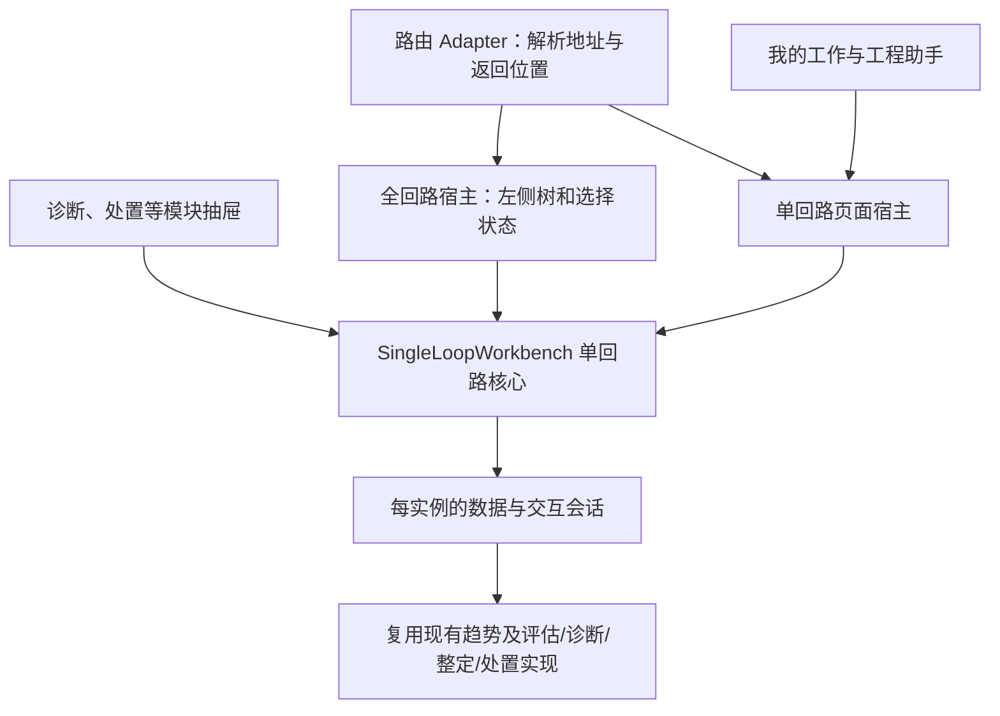

# 09 工程师任务导向 IA 与工作台组件增补

日期：2026-10-11｜状态：**用户已采纳推荐，纳入改造计划及评审；业务代码尚未实施本增补**

用户指示：“需纳入评审，按照你的推荐执行”；同时明确两种入口：全回路工作台由左侧装置—单元—回路树选取对象，单回路工作台直接带入回路编号，并提出组件化复用要求。

本增补是执行包对 [IA 主方案](/Users/zhangping/DEV/CLPM-MVP/docs/设计文档/工程师任务导向IA改造-2026-10-11/00-IA改造方案.md) 的吸收入口。页面迁移、工作语义、20 项基础验收及学习材料仍以该目录文件为正本，不复制成第二套要求。

用户随后明确收藏等必须由后端持久管理，已补 [个人收藏与工作接续数据设计](/Users/zhangping/DEV/CLPM-MVP/docs/设计文档/工程师任务导向IA改造-2026-10-11/03-个人收藏与工作接续数据设计.md)：账号关注、可跨设备偏好和最近继续由数据库保存，浏览器只缓存；纳入既有 P6-05/06，当时主任务数为 38。该细化的复核单独追加到 09 吸收登记，不沿用此前正文的历史 PASS。

用户已同意把装置优化整理入方案，新增 IAR-D8；正文见[装置性能优化方案](/Users/zhangping/DEV/CLPM-MVP/docs/设计文档/工程师任务导向IA改造-2026-10-11/04-装置性能核查与增强建议.md)。复用P6-01/02/03/04和P7-02，承接P1/P3统计成果，并与10号评估增补的N/E及F参考语义对齐。当前任务总数按03/README为41，本次不新增主任务。

三方案交叉复核及接续统一见[11号文](11-三方案交叉复核与融入计划-2026-10-11.md)和[12号提示词](12-zcode接续交接提示词-2026-10-11.md)。P3先处理全部现役消费者的最低语义兼容（含后台建议和已有AI洞察），本增补的完整IA仍在P6；旧洞察适配不算新助手已接通。INT组合验收把算法事实、装置下钻、个人工作与助手连起来，主任务仍41项。

## 1. 已采纳的决策与本轮范围

| 决策 | 已采纳内容 | 对原口径的影响 |
|---|---|---|
| IAR-D1 | 我的工作、工程助手、驾驶舱、专业作业、配置与管理五组导航 | 更新 DEC-07；旧 URL 和功能保留 |
| IAR-D2 | 工程师默认我的工作；观察者和管理员默认驾驶舱 | 替代“全角色首页驾驶舱”的目标口径；现行运行代码尚未改变 |
| IAR-D3 | 回路工作台、系统建议、我的关注、计算任务明确区分 | 统一导航、通知、页面和手册命名 |
| IAR-D4 | 账号级关注、最小核查载体；继续复用建议/工单 | 新业务能力进入 P6-05/06；字段及迁移先冻结再实现 |
| IAR-D5 | 独立工程助手及上下文面板；先查询/解释/导航，再受控行动 | 接入现行 CLPM/iCLPMagent 分工，不重建第二套协同平台 |
| IAR-D6 | 驾驶舱唯一出口改称进入工作区，按角色落地 | 保留六页签与舱内只读下钻 |
| IAR-D7 | 全回路和单回路两种入口，共用单回路组件 | 用户明确两种使用方式；据此采用下述组件方案 |
| IAR-D8 | 增强既有装置性能，三核心指标＋N/E和不足说明，趋势→单元→回路连续接续 | 驾驶舱摘要、装置集中分析、周期报告各负其责；复用现页与P6，不新增一级导航 |

已采纳的方向不重复提请确认。后续按现有阶段依赖、路径 Owner 和验收推进；没有把这次指令解释为 Git 提交/推送、生产操作、数据库已迁移或实现 Gate 已通过。

最新P2原批G2已登记通过，本次G2增量待接收，详见11号文；P6实现保留G3/G4/G5前置。现在可以完成方案吸收、调用契约设计和独立文档评审，不修改在途 P2 的实现树、数据库或任务状态。项目首期继续采用五角色单角色模型，本增补不引入多角色账户。

## 2. 两种入口的产品契约

| 项目 | 全回路工作台 | 单回路工作台 |
|---|---|---|
| 入口 | 专业作业中的回路工作台 | 我的工作、监控、诊断、整定、处置、助手中的具体回路入口 |
| 对象选择 | 左侧装置—单元—回路树，搜索和筛选；仅当前用户授权范围 | 宿主显式传入回路 ID；隐藏全回路树与对象切换器 |
| 工作区域 | 右侧显示选中回路的同一单回路组件 | 独立页面或模块抽屉/面板显示同一组件 |
| 内容 | 趋势/事实公共区＋评估、诊断、整定、处置四个剖面 | 相同能力；可指定初始剖面，按权限/模块状态展示 |
| 初始对象 | 无指定对象时先显示选择提示及关注/最近入口；有合法恢复对象可明确恢复 | 必须给出有效对象；无效、删除或越权不能回退第一条回路 |
| 返回 | 保留树展开、筛选及选中位置 | 返回来源清单/对话；抽屉关闭时恢复焦点 |

“全回路”指可在授权目录中选取回路；首版右侧一次处理一个选中回路，不同时挂载全厂所有回路的分析组件。左树以稳定装置/单元/回路 ID 组织，避免同名单元混在一起；回路叶节点按需加载、搜索在授权范围内执行、计数标明筛选范围和完整性。

页面上显示工程师熟悉的位号/名称；组件内部使用稳定 `loopId`。外部只有位号时，先按授权范围解析到唯一回路；重名、无匹配或无权时明确处理，不能模糊匹配后直接开始计算。

### 路由建议

- `/loop/workbench360`：保持现有地址，默认全回路模式。
- `/loop/workbench360?mode=single&loopId=…&section=diagnosis`：独立单回路页，直接定位指定剖面。
- 显式 `mode=all&loopId=…`：全回路树保留并选中该对象。
- 兼容旧 `embed=1`，规范化为 single；旧 `loopId` 直达而无 mode 的链接按 single 处理。该展示变化属于本轮两入口裁决，纳入书签回归。
- 非法 mode、无法识别的 section 或缺失的必需对象给出可理解提示，不静默丢弃。组件内嵌通过 props 调用，不构造 iframe 或嵌套路由。

`section=diagnosis` 为对外名称，现有内部 `diag` 由路由 Adapter 兼容映射。已禁用的剖面显示不可用原因；不静默改为其他作业。

模式优先级为有效显式 mode → 旧 embed=1 → 无 mode 的非空 loopId → 默认 all。全模式选择回路后写入 `mode=all` 与 loopId，避免刷新后被无 mode 的兼容规则切成单模式。非法显式 mode 直接提示，不通过低优先级参数掩盖错误。

## 3. 组件设计：一份作业实现，多个宿主



| Module | Interface 与职责 | 留在外部的事项 |
|---|---|---|
| 路由 Adapter（现有 index.vue 收敛） | 解析 mode/loopId/section/window/record，验证后构造统一上下文 | 将 URL、hash、router 和返回逻辑留在本层 |
| 全回路宿主 | 装置—单元—回路树、筛选、按需目录加载和对象选择 | 不复制四剖面，不创建第二套业务状态 |
| `SingleLoopWorkbench` | 接收一个明确上下文，提供完整单回路作业和真实结果事件 | 不读取宿主 URL，不加载全厂目录，不决定跳去哪一个页面 |
| 实例会话 | 选定证据、数据读取、请求代次、预填、局部 UI、订阅注册与释放 | 不保存到无对象身份的模块级可变单例 |

文件名是设计建议；新代码优先放在 `views/loop/workbench360/` 及其既有 composables/components 目录，先满足当前两个真实宿主，再评估是否迁入通用目录。保留 `AssessSection/DiagSection/TuningSection/HandlingSection`、`diagnosis-result-panel`、`use-tuning-workbench`、趋势与验证能力，不分叉实现。

### 3.1 最小调用 Interface

下面是帮助理解的伪代码，不是已实现接口，也不是新增必需依赖：

```vue
<SingleLoopWorkbench
  :context="selectedContext"
  presentation="drawer"
  @result-changed="refreshRelevantRows"
  @navigate-request="openAllowedDestination"
/>
```

| 输入/事件 | 含义与约束 |
|---|---|
| `context.loopId` | 唯一必需的业务对象身份；缺失时不开始请求 |
| `context.section` | 初始剖面；默认评估；其余剖面仍按有效权限及模块开放 |
| `context.window`、`evidenceRefs` | 时间、时区、结果和版本；传入时必须回显并真实消费；未提供时展示明确默认窗口 |
| `context.workRef` | 可选核查/建议/工单/方案关联；服务端验证与回路一致 |
| `presentation` | page/drawer/panel 的尺寸和外观适配；不改变业务规则 |
| `result-changed` | 带 loopId、工作/结果 ID 和变更种类；宿主定向刷新，不把“计算完成”当工单闭环 |
| `navigate-request` | 结构化目标；宿主负责路由、返回和过滤参数，组件不直接改外部 URL |

只读展示可由宿主进一步限制，但任何输入参数都不能授予操作权限。有效动作取登录主体、数据范围、模块状态和业务门禁的交集，API 再次校验。驾驶舱若复用只读内容，也不能因此出现可执行动作。

### 3.2 对象切换、草稿与生命周期

每个组件实例拥有独立会话。回路或证据上下文变化时先处理未保存输入，再替换会话；不得把 A 回路的预填、方案、工作引用或迟到请求结果写入 B 回路。同一回路切换证据窗口或记录也要核对身份，不能只比较 loopId。

首批推荐宿主根据规范化的对象与证据身份建立 keyed 会话，复用现有请求防竞态机制；组件仍需处理输入变化，不能要求调用方靠隐藏约定保证安全。尺寸变化不重建业务会话。关闭抽屉、取消导航、KeepAlive 停用/恢复的行为统一：停止无必要读取，释放本实例监听和订阅，返回时重新验证权限与证据。

组件关闭不等于取消后端计算；已启动计算可在既有计算任务中继续跟踪。确需取消时走原取消接口，显示实际结果。未保存内容在离开时明确处理，不能默默丢弃。

继续使用同一个 WebSocket 连接；由订阅 owner 汇总各可见实例的兴趣并集。关闭 B 实例只释放 B 的兴趣，A 的实时数据保持。缓存可共享，但键必须包含回路、窗口、证据/配置版本及必要授权身份；可变预填状态不得跨实例共享。

## 4. 当前基础与需要处理的耦合

静态核查基线：`main@baa3f50d8d883356064d5774c07122ebb5f360eb`。未做运行复现，以下为实现分支所支持的风险判断。

| 已有实现 | 本次拆分要解决的事项 | 源码 |
|---|---|---|
| embedLoopId/embedSection 与诊断抽屉调用 | 保留复用基础，将路由整页调用换成核心组件调用 | [index.vue:77](/Users/zhangping/DEV/CLPM-MVP/frontend/apps/web-antd/src/views/loop/workbench360/index.vue:77)、[诊断概览:792](/Users/zhangping/DEV/CLPM-MVP/frontend/apps/web-antd/src/views/diagnosis/overview.vue:792) |
| isEmbed 和路由 embed=1 两套状态；仍读 hash/query | 内嵌显示与对象不能被宿主网址影响 | [index.vue:85](/Users/zhangping/DEV/CLPM-MVP/frontend/apps/web-antd/src/views/loop/workbench360/index.vue:85) |
| 所有模式挂载 loadLoops；列表未命中回退首行 | 单对象直接读取；分页未到、无权或非法对象不换成另一回路 | [index.vue:561](/Users/zhangping/DEV/CLPM-MVP/frontend/apps/web-antd/src/views/loop/workbench360/index.vue:561)、[use-wb360-loop.ts:210](/Users/zhangping/DEV/CLPM-MVP/frontend/apps/web-antd/src/views/loop/workbench360/composables/use-wb360-loop.ts:210) |
| 两级树＋独立回路列表；单元按名称筛选 | 改为装置—单元—回路的对象选择层，按稳定节点身份定位 | [LoopSpine.vue:86](/Users/zhangping/DEV/CLPM-MVP/frontend/apps/web-antd/src/views/loop/workbench360/components/LoopSpine.vue:86) |
| 诊断/整定预填使用模块级 reactive | 调整为每实例上下文，保留一套预填实现 | [use-diag-prefill.ts:18](/Users/zhangping/DEV/CLPM-MVP/frontend/apps/web-antd/src/views/loop/workbench360/composables/use-diag-prefill.ts:18)、[use-tuning-prefill.ts:23](/Users/zhangping/DEV/CLPM-MVP/frontend/apps/web-antd/src/views/loop/workbench360/composables/use-tuning-prefill.ts:23) |
| 单连接 subscribe 替换兴趣集合 | owner 管理兴趣并集，避免多个工作台互相覆盖 | [use-loop-realtime.ts:192](/Users/zhangping/DEV/CLPM-MVP/frontend/apps/web-antd/src/composables/use-loop-realtime.ts:192)、[realtime-ws.ts:164](/Users/zhangping/DEV/CLPM-MVP/frontend/apps/web-antd/src/utils/realtime-ws.ts:164) |
| 量程请求结束直接写当前 ranges | 对对象、证据和请求代次校验，丢弃过期响应 | [use-wb360-loop.ts:250](/Users/zhangping/DEV/CLPM-MVP/frontend/apps/web-antd/src/views/loop/workbench360/composables/use-wb360-loop.ts:250) |

单回路所需标题、单位、质量、实时映射、权限等字段在契约阶段逐项核对已有 API；不足时补最小单对象查询，不以拉全厂列表作为回退。共享实时 composable 的修改必须登记所有消费页，避免只验证工作台而影响监控/测点页。

## 5. 纳入现有计划

| 工作 | 任务归属 | 依赖与范围 |
|---|---|---|
| 采纳决策、入口契约及组件设计评审 | 本轮 IAR-0 文档吸收；P6-01a 落地前复核 | 可提前只读评审，不抢跑实现 Gate |
| 稳定业务责任、关注、核查、个人聚合 | **新增 P6-05** | G3/G4/G5 后；复用 P4 权限与 P5 聚合基础，不复制处置状态机 |
| 双入口与单回路组件 | **扩展 P6-02a** | 先冻结调用契约；与 P6-05 可按不重叠文件并行；共享实时层单 Owner |
| 全链上下文与历史证据 | **P6-02b** | 基于 02a 组件，再完成各宿主与旧链接的语义校验 |
| 我的工作、关注、详情与导航落地 | **新增 P6-06**，结合 P6-01b | 依赖 05、02；复用系统建议和原业务操作 |
| 信息层次与岗位验证 | **P6-03/04** 扩展范围 | 包含双入口、多实例、空态、角色及真实岗位任务 |
| 装置性能集中分析与报告接续 | **P6-01/02/03/04、P7-02** | 三核心指标及N/E；装置/精确窗口/指标/版本连续；PL-01–06；不重开P1，消费10号文的评估统计成果 |
| 助手查询、解释与导航 | **新增 P6-07** | 依赖个人工作/证据协议及 iCLPMagent 集成契约，含配置入口 |
| 受控计算与业务写入工具 | IAR-4 后续扩展包 | 查询导航验收后逐工具冻结输入、影响、预算与幂等；方向已采纳，不算首版已实现 |
| 独立端到端与迁移 | **P7-02/03** 增补 | 覆盖新入口、存量责任迁移与新记录保留 |

本09首次吸收时主任务数由35增至38（新增P6-05/06/07），10号评估增补后当前总数为**41**；本次装置增强不新增主任务。P6-02a/b是原任务内部步骤不重复计数。原P6 4–6人日估算不再覆盖新增范围，应在契约冻结后重估。IAR-4单独列后续范围，不混入首版查询导航的完成报告。

IAR-A18 拆 a/b：a 是首版页面动作重入与上下文校验，纳入 G6；b 是受控计算/写入重试与回执，属于 IAR-4 的后续验证，不列作首版已通过。其余 IAR-A01–A28 按接入任务进入 P6/G6。

P6 内部顺序：01a 契约 → 05 与 02a 分工实施 → 02b/06 → 01b 导航与行动建议 → 07 → 03/04 综合收口。信息展示的独立工作可在不修改同一文件时穿插；G6 必须覆盖所有实际接入路径。

## 6. 组件专项验收

以下新增为 IAR-A21–A28，与主清单 IAR-A01–A20 共同适用。尚未执行，不记录 PASS。

| 编号 | 反例与预期 |
|---|---|
| IAR-A21 | 全模式左侧树按装置/单元稳定 ID 区分同名节点，搜索和分页正确；单模式没有全厂树/全量回路列表请求 |
| IAR-A22 | 直接传入列表末页回路 C，始终显示 C；不存在/删除/越权对象明确失败，不能回退首行 |
| IAR-A23 | 宿主 URL 是 A、组件传 B；所有视图与操作以 B 为对象，宿主 URL/筛选保持；mode 与旧 embed 链一致 |
| IAR-A24 | A→B 快速切换，以及同回路换窗口/recordId；A 的迟到趋势、量程、历史、预填不污染 B；未保存输入不静默丢失 |
| IAR-A25 | 全工作台 A 与模块抽屉 B 同时打开，预填隔离、实时均正确；关 B 不停 A；多次打开/关闭与停用/恢复不积累监听 |
| IAR-A26 | 单组件指定四种剖面、历史证据与业务工作；实际消费并回显；模块禁用、只读宿主与越权 API 均不能绕过门禁 |
| IAR-A27 | 页面/抽屉/面板尺寸和主题切换、键盘操作；无双导航/嵌套整页滚动；关闭回到原触发位置 |
| IAR-A28 | 操作产生真实记录后宿主只刷新相关对象；组件关闭不假称取消后台计算；外部计算完成不误关业务工单 |

验收证据包括组件 Interface 测试、真实宿主往返与双实例浏览器案例、请求/订阅及后端权限证据；结构断言只能辅助，不能代替这些行为验证。

## 7. 评审记录与当前完成边界

装置专项PL-01–06正文及任务映射见配套装置方案§5.1，补充原IAR/C/EA案例，纳入G6/P7；没有把当前页面可见当作验收通过。本次装置吸收的独立复核和版本快照在09登记追加，以下组件历史PASS仅适用于原复核范围。

本轮完成用户裁决登记、两入口和组件 Interface 设计、代码耦合核查、计划/验收映射。独立非作者 `ia_component_review` 对最新正文复核为 **PASS（设计文档）**，无剩余实质缺陷；初审提出的 A18 首版/后续范围冲突已拆为 a/b 并复核。记录及交付文件 hash 见 [09 吸收与评审登记](执行状态/09-IA吸收与评审登记.md)。本结论不沿用基础包 v1.2 的历史 PASS，也不代表软件运行或实现 Gate 通过。

本轮没有修改业务源码、运行环境或数据库，没有派发其他 chat，也没有修改自动生成的任务看板。代码实施沿现有阶段前置和唯一 Owner 机制接续。

现有冻结原型的非冲突视觉与交互继续保留；两入口和组件布局的差异在实施前同步登记原型变更记录与设计方案。不会仅凭旧原型的层级否定本轮已采纳裁决，也不会把新设计文档误当作运行界面已改变。

## 8. P6 接续提示词（准备稿，前置满足后使用）

### 1. 必读清单

- AGENTS.md 现行 MVP、路径纪律、真实数据、下钻与 Git 约定。
- 本执行包 01 的有效裁决、03 的 P6、04 验收及本 09 号文。
- IA 主方案与迁移清单；G3/G4/G5 报告和当前候选 SHA。
- 装置性能优化方案及PL-01–06；10号文§3.6的完整P可评分N/E、分项独立聚合与F参考统计契约。

### 2. 阶段范围

- 按 09§5 依赖实施 P6-01–07，02 含双入口与单回路组件拆分。
- 先冻结关注/核查/聚合/组件/跨仓工具契约及精确文件 Owner；复用既有功能。
- 新工作台代码留在 workbench360；宿主页、共享实时层等按逐路径清单串行修改。
- 装置性能、指标分析、驾驶舱、报告按P6精确文件Owner实施；旧页面接入仅限已采纳职责、范围/时间接续和证据显示，禁止借本增补扩展无关改造。
- IAR-4 受控写入不冒充首版范围；既有数值语义不在 IA 中重定。

### 3. 执行纪律

- 核 G3/G4/G5 和运行环境归属后才能实施；不得借用在途环境。
- ORM 与迁移同批；历史姓名歧义不自动归人；不复制原工单状态。
- 已采纳的 IA 决策不重复询问；本指令不授予 Git/生产操作。

### 4. 完成度核验

- 每项任务、IAR-A01–A28、装置PL-01–06及既有C/EA的相关反例是否有对应证据？
- 与变更相称的 lint、单测、typecheck、build、迁移及端到端门禁是否有真实分母？
- 是否有未验/跳过项、跨 Owner 改动、旧链接或共享实时回归？
- 是否更新阶段交接、文档与后续范围；是否具备真实岗位验收而非仅代理走查？

### 5. 需要形成具体结果后处理的决策

- 新发现的重大语义/路径范围冲突、数据迁移审查、环境归属冲突和正式阶段验收。
- 已批准内容不重开；Git 提交/推送、main 合并和生产部署遵循用户单独授权。
