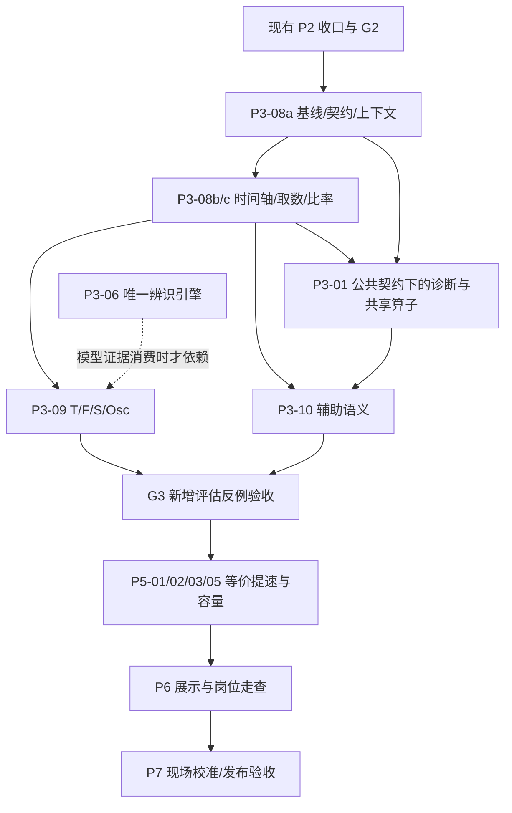

# 评估算法改造增补方案

版本：v1.1；日期：2026-10-11；状态：**用户五项决策及 F 参考分补充答复已吸收；业务实现未启动，保留 G2 前置**。

本文是《系统改造优化》的 **10 号增补（评估专项 EA）**，承接本会话对 27 个指标计算器及综合评分 P 的复核。原 08 评估文保留转向入口，08 号正式编号归诊断专项，避免派工混淆。2026-10-11 用户五项决策见[决策与吸收登记](执行状态/10-评估算法决策与吸收登记.md)；已采纳方向不重复询问。本文是实施契约，不表示代码已实现或已经部署。

## 1. 目标、基线与边界

### 1.1 要达到的结果

1. 有效自控、自动、饱和、带内比例不再跨未知区间补时；短模式/质量事件不会因为复用粗网格而消失。
2. T/F 明确区分当前平稳、动态证据不足、观察窗内未收敛与可估计；振荡短暂过零不能提前判稳。
3. 数据质量、统计线索和设备故障的表达一致；无依据时不产生确定的满分、无故障或完全非线性结论。
4. 新旧结果可区分、可解释、可回放；结果差异来自指定输入、算法和参数，不能来自当前进程里的隐含默认值。
5. 在正确性冻结后降低相关计算、重复解析与数据复制的开销，以真实标准小时任务验证容量。

### 1.2 本次核对基线

| 对象 | 本次事实 | 使用方式 |
|---|---|---|
| 主仓 | `/Users/zhangping/DEV/CLPM-MVP`，`main@baa3f50d8d883356064d5774c07122ebb5f360eb` | 方案保存位置，不作为算法最新实现基线 |
| 上轮算法审阅 | `feat/p1-integration@4bc7e43f16cb2ae08debdd85e89c04843df36911` | 既有发现的固定依据 |
| 本轮增量核对 | `/Users/zhangping/DEV/CLPM-MVP-p1int`，`d4edcf28a6b2f27c7570b2d552b9cb0b48e3c660` | P2-03 已合入；相对上轮主要新增不可变输入包、重放及上下文接线，未修改各评估算法公式文件 |
| 决策吸收时执行资料 | P2-03 非作者验收记录、Git 提交及 11:57 看板 | P2-03 已合入，P2-04 在途、G2 待收口；看板为投影，晋级以最新 Gate 正本核定 |

本轮只读源码、核对文档并编写本方案；未运行产品测试、压测、服务或迁移。P2-03 报告记载的 PASS 及测试数字属于原验收证据，不是本轮复跑结果。本文新增跨算法版本/配置版本反例，补强原验收覆盖，不把原有同构建输入包验收扩大解释为全部历史可复现。

### 1.3 与现有工程的关系

- 延用 P0～P7，不新建第二条辨识、诊断或整定引擎；07 号文的 P3-06 是过程辨识唯一实施主体。
- 已纳入 **P3-08、P3-09、P3-10** 三张任务卡。连同已吸收的 07 与 09 专项，主任务总数 **38→41**；诊断 D 子包不另计主任务。新增任务状态为未启动，本文不改变在途任务或生成式看板的运行状态。
- 复用 P1 结果账本、P2 参数发布与输入包、P3-01 诊断有效性、P5 容量设施、P6 展示、P7 现场校准。
- A 工程容限、F 分段评分映射、S 条件振荡修正、AR+Green 近似已有冻结裁决。改判稳或可判定性走新版本；不静默切换为 GB/T 参考公式，不宣称标准符合性已经完成。
- 不直接下写 DCS；提交、推送、合并 main 和部署按项目既有授权执行。本次方案编制不启动这些动作。

## 2. 现有能力与新增问题的对应关系

| 编号 | 问题与影响 | 改造落点 | 主要验收 |
|---|---|---|---|
| EA-01 | HF 复用 2/5/10 秒 BASE，短手动/饱和/Bad 事件可能遗漏 | P3-08b：DataPlanner、逻辑宽表、缓存身份 | C03-EA1 |
| EA-02 | mask 压缩时间轴，R/Auto/Sat/带内率可能跨坏区间计时；末点可能超窗 | P3-08b/c：统一时间视图及比率消费 | C03-EA2、C04-EA1 |
| EA-03 | R 检查值缺失，但未检查 PV/SP 逐点有效性 | P3-08c：有效自控分子资格 | C03-EA3 |
| EA-04 | Good 主路径看质量码，回退看综合有效性 | P3-10a，时间计算复用 P3-08 | C04-EA3 |
| EA-05 | 静稳直接产生 T=0/F=100，动态能力证据不足 | P3-09a：估计资格与输出语义 | C07-EA1 |
| EA-06 | 首个短暂低于阈值的窗口可能被判稳 | P3-09b：Green 收敛判据 | C07-EA2/3 |
| EA-07 | S 把缺失振荡结果按 0 处理；暂态剔除依赖点数 | P3-09c：依赖状态与时间参数 | C07-EA5、C14-EA1 |
| EA-08 | 围绕 SP 的 IAE 不覆盖偏置振荡；采样改变物理周期门槛 | P3-09c：连续段与补充周期证据 | C14-EA2 |
| EA-09 | 粘滞/仪表/相关性指标把缺证据表达得过于确定 | P3-10b + P3-01 单 Owner | C15-EA1/2、C16-EA1 |
| EA-10 | 穿越零平台、平均绝对偏差与振幅、OP 活动与实际阀位易混淆 | P3-10c：语义、连续段与显示元数据 | C16-EA2/3 |
| EA-11 | 时间常数粗估混合 τ 与 θ，有限滞后可能截断慢过程 | P3-10c；估计器升级由 P3-06 | C16-EA4 |
| EA-12 | A 容限、T′与输出限位依赖工程事实和工况 | P2-04 消费链 + P7-01 校准 | C04-EA2、C07-EA4 |
| EA-13 | 全长相关 O(n²)，但只消费少数滞后；mask/缓存重复成本 | P5-01/02/03 | C29-EA1 |
| EA-14 | 新旧算法/参数并存缺少严格执行隔离、完整结果比较及发布保证 | P3-08a + 结果/上下文原 Owner | C12-EA1/2/3 |
| EA-15 | 整回路SUCCESS筛选会丢有效分项，evaluated_loops不等于完整P可评分数 | P3-08d固定名册与分项独立聚合 | C26-EA1/2/5 |
| EA-16 | 上级统一按evaluated_loops加权，丢失各指标真实分母及F参考构成 | P3-08d每指标充分统计量；P5等价提速 | C26-EA3/4 |
| EA-17 | 去均值误差σ小不足以证明静稳参考资格，同步斜坡也可能命中旧分支 | P3-09a原时轴资格/配置/反证 | C07-EA6 |

不重复作为未修事项：A 旧归一化基准、PV/SP 整体缺失、F 非默认容差跳变、NaN/Inf 出口、动态算子已有缺口守卫、输出行程六位精度、已完成的 IAE 相似率线性化与冻结检测前缀和。

## 3. 已采纳方向与实施契约

本节落实用户五项决策及补充答复“F 也保留参考分值用于装置统计，并显式标注动态证据不足”。新版本保留静稳 F 参考分、显式计算可评分比例，并在验收后直接采用新算法；不再要求影子运行或限定节点试点。内部数值容差/样本预算由工程负责人在测试前登记，不重复询问已批准的业务方向。正式启用仍须满足既有验证及部署授权边界。

### 3.1 一个时间视图，分别表达已知、无效、未知

复用 `DataBlock`、`SeriesContext`、逐角色 `validity`、覆盖区间和分段边界。建议新增薄层 `backend/app/services/metric_calculator/time_axis.py`，只做转换和区间统计，不建立第二套原始时序存储。写入前先核现有 helper，能扩展则不另建。

推荐接口责任：`build_metric_time_view(bundle, window, required_roles)` 产生原槽索引、每槽有效区间/秒数、逐角色资格、连续片段，以及覆盖摘要。窗口是明确的 UTC 半开区间 `[start,end)`，最后一个槽截到 end；不得复制上一段时长越过窗口。现有 SeriesContext 的含尾网格转半开区间由这一处适配，并覆盖 1/2/5/10 秒网格。

- OBSERVED：有观测依据；HELD：满足现有 COV 保持/覆盖契约时有状态依据，可用于合适的比例统计。不能把所有 HELD 都当缺失，也不能把 HELD 当作每秒新观测来证明仪表冻结。
- BAD/INVALID：已知记录但不满足某项数值资格；保留原值与原因。UNKNOWN：断线、无初值、冲突、未绑定等无依据区间；不推断自动/手动、饱和或偏差合格。
- 缺口、改绑、量程/单位解释切换、被剔除暂态均形成动态片段边界；不得删除后拼成连续信号。
- 参数中依赖采样周期的最短点数、实际秒数、有效频带同时保留；改成秒不意味着可以降低到只有一两个可信点。

**建议比率规则：** R/Auto/Sat 的分母使用完整请求窗口秒数；分子只计有依据且条件成立的秒数。另输出 `unknownSeconds`、`knownSeconds`、`coverageRatio`、`numeratorSeconds`、`denominatorSeconds` 和分母口径。

| 指标 | 有依据的分子条件 | 未知时的推荐输出 |
|---|---|---|
| R | 有效自动模式、有效 OP 且未饱和、PV/SP 有效且偏差合格 | 不能确定的段不补时；返回全窗已证实比例及可能区间。PV/SP 已标 Bad 的段按契约不能计有效，不当作“有数值就合格” |
| Auto | 已知有效自动模式 | 同时给已知自动比例及 unknown，不能把 unknown 标作手动 |
| Sat | 已知自动模式且有效 OP 贴真实限位 | unknown 不等于已确认未饱和；保留严格端点及已批准 epsilon 配置 |
| 带内率 | 非暂态评价域内有效 PV/SP，且偏差落在允许带内 | 分母为窗口减去**已知被剔除暂态**的时间；未知仍单列，不借未知缩分母；评价域为零则不可判定 |

例：100 秒中已知自动 40 秒、未知 20 秒、已知手动 40 秒，Auto 已证实比例为 40%，可能范围为 40%～60%，覆盖率 80%。不能报确定的 60%，也不能把未知改成已确认手动。若 R/带内率等参与 P 的值仍存在无法消除的状态区间，**新 profile 的 P 返回不可完整评估**，展示可用分项与范围；不对剩余权重重新归一化。只有不影响分子判定的未知，才允许通过三值逻辑缩小为确定结果（例如已知手动段的 R 必定不成立）。

上述 `PARTIAL` 是指标证据状态，优先放 `MetricResult.details`，不直接写入只允许 COMPLETED/FAILED 的账本 status 列。推荐 `details.assessmentState=COMPLETE/PARTIAL/UNASSESSABLE`；P 必须检查必要分项的这个状态，不能因 value 有下界数值就当完整结果。数据可信度 A～E 的现有门槛继续约束可计算性，不因本次改造放宽。

### 3.2 高频事件与共享取数

正确性首版：如果 BASE 实际周期大于 HF 所需周期，禁止直接将它标成 HF 使用；先恢复符合 HF 契约的独立读取并核对状态事件。这是最小可靠落点，允许暂时增加读取成本。

后续 P5：在同一源读取上下文中共享完整事件与覆盖，再分别生成 HF/BASE。共享的是原始事件，不是已经丢失细节的粗网格。动态模拟量降采样需要抗混叠和有效频带契约；不得用趋势图 LTTB 输入替代评估输入。

所有派生数据记录实际周期与派生方法，缓存身份纳入数据策略、网格、窗口、源修订、绑定与解释版本。长窗分块处理、保留片段边界；不足预算时异步或明确拒绝，不静默截短窗口。

### 3.3 T/F 与 S/Osc 的证据

| 情况 | 新 profile 的推荐行为 |
|---|---|
| 当前平稳、没有可识别动态 | 保留 `currentlyStable=true`；T/F 正式 value=null，原因 `NO_DYNAMIC_EVIDENCE`；F 另保留 `details.referenceScore=100`（静稳规则参考分）用于装置参考统计，显式证据不足；需要 F 权重的 P 不给完整总分。资格、聚合与显示见§3.6 |
| 连续数据与动态资格通过 | 可给 AR 偏差衰减估计，标 `method=error_ar_decay`；不能称为已测得真实过程模型。资格复用现有激励检查/连续段，并验证输入、噪声和闭环影响 |
| 模型推演时域内不收敛 | 给模型衰减时间下界，F 可给对应上界作为 details，不把下界当精确 T 或据此给满分；点估计与 P 为不可完整评估。此下界不是已经现场测得的真实恢复时间 |
| 振荡结果无法计算 | 指数 S 的完整值不可判定，保留可复算的波动基础分；不默认 Osc=0。带内模式按其独立契约处理，不额外强加振荡依赖 |
| 只有偏置振荡证据 | 保留旧的围绕 SP 的 Osc；新增独立诊断证据，不直接替换旧指标或重复扣 S。纳入 S 属后续有明确验证的版本裁决 |

AR 阶数、5% 阈值、F 分段映射沿现行冻结值；本次不引入完整 ARMA。推荐收敛判据是：从候选点到当前有限模型推演时域结束全部低于阈值，且尾段满足最小持续时间与最少可信样本数。实现可用从后向前的最大绝对值扫描 O(G)，G 为 Green 点数。分别报告真实输入 `observationSeconds` 与 Green `simulationHorizonSeconds`，不能把模型外推写成真实观测；这只是有限推演时域内持续收敛，不声称无限未来保证。极点不稳定、输入不足或推演尾段不足时拒绝给确定 T。

建议最短持续条件为 `max(3×dt,10秒)`；若模型极点给出可信振荡周期，再要求尾段至少覆盖一个该周期。周期取所有被采用复极点对应周期的最大值，近实根/不可解析周期不凭空生成周期条件；数值容差随 EA-D03 冻结。尾段不足时报告候选进入带时刻及 `INSUFFICIENT_TAIL_SUPPORT`，T 点估计仍为 null。不通过增加观察窗到任意长度绕过预算；不把变化的收敛规则塞入“数值等价优化”。

**数据好与动态不可判定分开：** 当前 `_make_inconclusive` 会返回 confidence_level=E。新 profile 为兼容保留该结果字段，同时在 details 明确记录原 `dataQualityLevel`、`assessmentState` 和原因；新算法启用前的最小读端适配使用真实 dataQualityLevel，P6 再完成全场景走查，不能把 `NO_DYNAMIC_EVIDENCE` 画成数据坏或自动降为 L0。例如数据质量 A、F 参考100但动态不可判定、P 不完整可以同时成立。适用性门禁仍按真实数据条件计算，不能因缺少动态变化重写原始质量标记。

S/Osc 的 SP 暂态剔除改为可追溯的真实秒数。兼容迁移把旧点数乘该回路声明周期转换为初值，并记录来源，避免无意将 5 秒采样的 60 点变成 60 秒。后续按 T′和工艺校准。振荡采用“最少可信样本＋工程周期范围”双条件，而非直接把 8 点改成 8 秒。

偏置振荡候选复用现有诊断/谱分析能力：连续段上分离偏置与允许的慢趋势，再验证幅度、周期一致性和完整周期数；分别测试正弦、偏置正弦、漂移、噪声及 SP 阶跃。只产生辅助证据，不另造评分引擎。

### 3.4 各辅助算法的改造规格

| 算法 | 本次规格 | 预期效果 |
|---|---|---|
| A | 保留公式；复用P2-04工程事实载体，P3-08a/09a联合P3-03补允许偏差的来源/单位/解释版本并消费；归一化信号与容限同量纲 | 对应真实工艺要求，避免容限随不合适量程变宽 |
| T′ | 保留手动优先/默认回退且显式标来源；模型法只消费 P3-06 已通过独立终验且工况匹配的模型，不能将粗估 τ 直接注入 | 参考速度更公平，减少模型误用 |
| Good | `good_value_rate` 明确为质量码 Good 的时间比例；新增 details 内 `usable_rate` 表示数值可用比例；缺质量码时返回未知，不用 pv_valid 冒充 QC Good | 分清来源质量与算法可用性；历史 key 不改含义后仍需版本区分 |
| 阀门线性/非线性 | 保留存储 key；展示为 PV–OP 线性相关代理；零方差→不可判定，非线性依赖同样不可判定 | 避免静稳回路被解释成完全非线性 |
| 阀门运行区间 | 保留 min/max 统计，名称解释为输出指令范围；实际阀位是另一证据来源 | 不把指令当成实际行程 |
| 粘滞 | P3-01 负责资格及计算；非极限环/动作不足用“本方法不适用/未检出特征”，不能确诊无粘滞；检验正反作用、纯滞后与缺口 | 减少错误归因及错误排除故障；不宣传真实故障百分比 |
| 仪表故障率 | 保留异常类型范围；缺 OP/时间依据时保留 frozen 候选及未确认原因，不自动升级为已确认故障；OBSERVED 与正常 HELD 区分 | 减少平稳/慢过程及保持数据误报 |
| 穿越次数 | 连续段内用最近非零符号处理零平台；死区初值为 0，保留精确统计；新增可配置死区时由工程分辨率/噪声依据确定，值为 0 时也不跨缺口连接 | 修复零点漏计，后续可抑制噪声虚增 |
| “振荡幅值” | 保留旧 key/数值，展示与帮助明确“平均绝对偏差”；真正振幅单独从已验证振荡证据输出，不复用旧 key 偷换定义 | 分清偏置与摆动 |
| 输出行程 | 每个连续有效片段内累加 OP 变化；不累加跨缺口差；报告已知时间、未知时间与采样分辨率；仍称指令活动量 | 避免断点跳变和粗采样误读 |
| 描述统计 | 保留样本均值/标准差；明确均匀网格/样本口径；非均匀输入若需要时间均值则另输出，不静默替换 | 保持已有可复算数值，改善解释 |
| 时间常数 | 展示为“相关响应时间粗估”，记录实际搜索秒数与截断/资格；τ/θ 分离交 P3-06 唯一辨识引擎 | 避免把 τ+θ 粗值当成精确 τ |
| P | 保留 A/F/S 权重汇总和 R 折扣结构；缺失必要分项不改权重凑总分；附分项、基础分、R、版本与覆盖 | 总分可解释，版本间差异可追溯 |

### 3.5 不可变计算上下文与版本

新算法运行必须固定：`assessmentProfile`、`algorithmVersion`、`dataPolicyVersion`、`configRevision`、实际解析后的 `resolvedMetricParams`、工程事实、输入包及 `inputHash`、实际执行 `executableBuildDigest`。版本由统一来源发布，清除任务/计算器/汇总各自硬编码版本造成的漂移；推荐候选名 `KPI_CALC_v3.0-rc1`，具体编号在 EA-D05 冻结。

profile 分发使用服务端编译确定的枚举/策略表，接入现有 calculator 注册器和任务入口；不得接收任意模块路径或客户端代码。当前构建保留通过旧golden的 legacy 策略与候选策略，复用共同实现，不复制整套27计算器。选择profile时同时选择匹配的数据策略和参数schema；只改版本字符串不构成旧版回退。

已有事实：P2-03 可保存输入包，但 `replay_result_record` 调用当前进程计算器；保留清单检查不等于真的运行旧构建。当前比较主要看子指标 value，未覆盖 P/原因/缺失集合。包中 KPI effectiveParams 的主要内容是权重与 fitness，计算器仍可读 `algorithm_config` 进程缓存。

**归属纠正：** 原 P2-03/C12b 已要求旧参数与旧构建复现。G2 前由原 Owner 增量复核 C12-EA1/2 中属于原契约的部分，并修复确认的缺口；P2-04 可继续实施，不另派并行写同一基础文件。不能把原承诺整体后移 P3 后仍宣称 G2 原范围全通过。P3-08a 接收该成果，补新 profile、原事件对照、完整语义比较和发布代际能力，不重复实现。

共同的实现要求如下，逐项在 G2 接收清单中标明已完成/本次增量：

1. 计算入口一次解析完整参数，以不可变上下文传给各计算器及其依赖；重放显式注入包内参数，不读取当前 DB/进程默认。禁止临时改全局缓存再恢复。
2. 旧构建重放优先采用保留的代码/锁文件环境中的**无网络、只读输入包的独立计算进程**；不启动额外 Celery Worker/Beat。执行器回传并核验实际 build digest。未具备该执行环境时，跨构建重放明确拒绝，不能仅因 digest 列在名单就调用当前代码。
3. 比较指标集合、null/数值、状态、原因、分母、覆盖、方法/参数身份、参考分/参考政策/统计构成、P与等级；只排除生成时间等非语义字段。差异完整列出。
4. 旧包缺少实际参数或必要身份时标“不可完整复现”，保留旧结果查看，不伪补当前配置。只做新版本重评时必须叫重评。
5. 沿用 DEC-10：例行小时 KPI 默认不全量落包；显式样本与离线验收对照落包并保留。抽样数量/预算预先登记，不能自动扩大至全部历史；不为本专项新增线上 SHADOW 模式。

**两种对照输入必须区分：** 现有 KPI_GRID 包保存已经生成的 DataBlock。公式/提速对照可复用同一网格包；HF/数据策略对照则需在同一时点冻结原始事件、质量、缺口覆盖、窗口前初始状态、绑定与单位解释，分别派生旧/新网格并记录原事件包 hash 与两个派生包 hash。扩展现有快照服务的包种类/schema，不新建另一套存储。原事件→旧网格→新网格的差异与同网格→新公式的差异分开报告。缺原事件的旧粗网格包无法恢复短事件，只能做公式重放，不可伪称已验证取数修复。

### 3.6 可评分比例、F参考分与装置统计（用户决策新增）

**三个概念分开：** 数据质量说明输入是否可靠；完整可评分说明必要证据是否齐全；参考分是已声明规则下供管理比较的数值。分值存在不代表动态能力已经测得。S 是平稳程度，F 是响应快速性，本次用户明确要求 **F 也保留参考分**。

#### 3.6.1 静稳 F 参考分

- 正式动态 `fast_rate.value` 在缺动态证据时仍为 null，T 也为 null；不虚构 T=0 秒。对满足静稳参考资格的窗口，另保存 `details.referenceScore=100`、`referenceMethod=STATIC_WINDOW_POLICY`、`referencePolicy=STATIC_BASELINE_100_V1`、`evidenceStatus=INSUFFICIENT_DYNAMIC_EVIDENCE`、`reasonCode=NO_DYNAMIC_EVIDENCE`、规则/参数版本及所用时段。100 沿用现有产品“静稳参考满分”约定，**不是测量值、置信概率或真实响应速度**。正式指标 `assessmentState=UNASSESSABLE`，参考值资格单独记录，不因 referenceScore 非空变 COMPLETE；referencePolicy进入快照和复现比较。
- 参考资格：满足真实数据质量、连续观测时长/样本、单位量程和时间轴要求；PV 在冻结噪声/趋势范围内；无超过已发布门槛的 SP 事件、OP 激励及已知模式/工况变化；无已确认质量/仪表故障反证。参数通过既有注册/发布链记录，不仅凭旧 `already_stable` 标记或去均值后偏差标准差小发100。合法HELD可用于状态统计，但不足以单独证明持续新观测的静稳资格。
- SP/PV 同步爬坡即使误差恒定，也不满足静稳参考资格。持续恒定偏置若其他静稳条件成立，可保留政策参考100，但同时显示 A/R 及偏差；“平稳”不能改写为“偏差合格”。恒值本身不能证明仪表正常，只有波形候选时保留未确认提示，不能以候选确定设备无故障。
- 缺数据、算法异常、配置失效（含非法T′）、未收敛、仅有上界或尾段不足不能套用参考100。未收敛的 F 上界保留在边界字段，不作为装置点值；依据不足则参考值也为空。具备完整动态证据时用实际公式得到正式F，不叠加参考100；输出时两种资格互斥，兼容读取如遇残留参考字段仍以合法正式F优先（包括0分）。
- 页面显示例：“快速性参考分 100 · 动态证据不足（静稳规则）”，解释“当前窗口无可识别响应过程”。静稳参考资格、T/F推断与数据质量独立可查。此参考分不进入正式P；如果F权重非零且只有参考值，则P不完整，不重分配剩余权重。F权重本来为0时按该profile实际必需分项判断，不能额外强加F要求。

#### 3.6.2 显式计算完整可评分回路比例

每个指定装置/权限范围、评价窗、目标算法profile、配置及组织版本，固定参评名册（记录 membershipRevision/回路ID及排除原因）。分母 `eligibleLoopCount=E` 沿现行启用/参评规则，**缺数据、缺动态、失败、取消、尚未计算都不从E删去**。停用/主动不参评等既有排除原因另报 `excludedLoopCount`；不新增以数据不足为由的排除条件。

`scorableLoopCount=N` 只计本窗指定正式版本的 P 为有限数值、必需分项证据完整且通过原有效性门禁的唯一物理回路。真实0分算可评分；仅有F参考100不算。`scorableLoopRatio=100×N/E`；E=0返回null并显示“无参评回路”，E>0而N=0显示0%。它是**完整P可评分比例**，不冒充数据覆盖率、算法准确率或执行成功率。

API/节点快照必须同时保存并显示 N/E（例如“60%，6/10 条”），以及互斥状态账：`E=scorable+incomplete+failed+cancelled+pending+missing`。incomplete包括已完成但P证据不足/不可判定；failed/cancelled是已知任务终态，pending是已登记未终结任务，missing是无对应记录/任务。原因细分和各指标参考数另作标签，不重复加进该等式。所有已确认结束的批次pending应为0；缺记录不能藏在成功总数中。

从指定版本、窗口和正式发布身份选代表结果，不能先筛SUCCESS再挑旧成功记录，也不能把当前 `evaluated_loops` 直接当N。物理回路数和复杂组评分对象数分别返回：若使用复杂组代表做分值聚合，按现有冻结规则固定代表及成员，另报objectCount/对象覆盖率，禁止“组数作分子、物理回路数作分母”，也不把组分数复制给未产生完整P的成员来增加N。旧结果缺元信息时标覆盖率历史口径不可追溯，不猜算。

#### 3.6.3 每个分项独立汇总

P不完整不会删除仍然有效的S/A/Auto等分项。节点即使没有任何完整P，也必须产出参评数、可评分比例、原因分布及可用分项，不能因为没有SUCCESS/P直接返回空。S指数模式缺Osc时保留基础波动参考分，若参与统计必须单列相同基础公式；不与已扣振荡的完整S混成无说明均分。带内模式仍按自身公式，模式不同分组显示。

F提供两份统计：

1. **快速性参考均分（主参考展示）**：同一profile下，每个固定聚合对象有完整正式F则取正式F；否则只有满足§3.6.1的静稳参考分才取referenceScore；其他对象不进入点值平均。按既有回路/组重要度权重计算，输出 `fastRateReferenceMean`、`referenceWeightedNumerator/referenceWeightSum`、`numericCount/dynamicEstimateCount/policyReferenceCount/unavailableCount`、`policyReferenceWeightShare`。其中dynamicEstimateCount+policyReferenceCount+unavailableCount=本指标参评对象数。只要含参考值，名称/徽标必须明确“含N条（或N个评分对象）动态证据不足”；它是管理参考统计，不宣称全部响应速度已经验证。
2. **动态证据充分的F均分**：只用完整正式F，输出 `fastRateDynamicEstimateMean`、独立分子/权重分母/样本数及 `dynamicEvidenceCoverageRatio`；无完整F时为null，参评数大于0而动态数为0时动态覆盖为0%。此处是有资格的动态估计，不称“现场实测快速性”；该子集均分也不能宣称代表未覆盖回路。参考汇总与正式字段分别编码，不把混合参考均分回填旧 `fast_rate` 或正式P。

对每个指标独立保存入选对象、加权分子、权重和、完整/参考/不可用计数与名册身份；展示贡献对象数/预期对象数。零值参与、null不作0；配置允许的零权重对象保留计数但不贡献均分，权重和为0时均分null；非法负权重按参数错误处理。装置到全厂合并分子与权重和，不能平均各装置百分比/均分，不能统一用 `evaluated_loops` 给所有指标加权。

完整P比例按物理回路名册合并并去重；每指标按自己的合法聚合对象合并。24h/30d若合并小时窗，显示“回路小时可评分比例”，分母是回路×小时；另有独立回路统计时须单列，不能把重复小时说成不同回路。页面、报告、导出、排名、下钻使用相同scope/window/profile、状态过滤和分母；参考分不能偷偷获得正式P等级或成为设备改善证明。

## 4. 任务分解与执行顺序



三方案接收与共享Owner以[11号文](11-三方案交叉复核与融入计划-2026-10-11.md)为准。D0/08a先冻结接口，P3-01供给共享纯算子，P3-10/09a消费，不同步互调整套诊断/KPI；P3-01不反过来等P3-10全完成。EA-D05仅约束评估发布；诊断仍按08§10.2。

图中 G3/P5 仍需满足主计划的其他既有前置（包括 G4），本图不提前放行。P3 新增分项/参考统计及最小 API/读端兼容属于正确性，不后移 P5/P6；P5 优化同口径聚合性能，P6 完成全部展示与岗位走查。新语义正式启用前，所有仍可访问的页面/报告消费者必须兼容 null、参考分和可评分比例。界面文案设计和独立样本标注可提前并行。

### 4.1 P3-08：评估输入、时间质量与比较基础

**输入：** 固定集成 SHA、G2 正本、本方案 EA-D01/05、现有 P0 语义冻结与反例。Owner：评估后端；原配置/结果账本 Owner 审核公共接线。

| 子步 | 工作与文件 | 输出与完成判据 |
|---|---|---|
| 08a | `contracts/data_types.py`、`services/{algorithm_config,calc_snapshot,result_ledger}.py`、`tasks/kpi_calc.py`、`models/calculation_result.py` | 先核 G2 原复现契约接收清单；补比较 manifest及原事件/派生包身份、新profile和完整语义比较、发布代际；C12-EA1/2/3；旧包不伪装可复现 |
| 08b | `services/data_planner.py`、`data_source/logical_wide_builder.py`、`contracts/series_context.py`、`preprocessing/{pipeline,input_guards,quality_summary}.py`、候选 `metric_calculator/time_axis.py` | 原事件/初值/覆盖抽样落包与旧新派生双hash；真实 HF；半开时间轴；连续段及 UNKNOWN；C03-EA1/2、C04-EA1；不改变正常 COV 保持合法性 |
| 08c | `metric_calculator/{effective_auto,auto_mode,saturation,stability}.py`、契约注册及 `db/postgresql/02_seed_data.sql`（仅需要时配迁移） | 原时间轴消费；R 坏 PV/SP 不进分子；限位同量纲；分子/分母/未知可对账 |
| 08d（原任务内部步骤） | `services/{node_performance,workbench_precalc,workbench_assessment}.py`、现有 performance/工作台 API 与类型；沿实际调用确认节点存储和全部读端 | 固定参评名册；完整P可评分率；指标独立聚合及充分统计量；F参考统计字段接09a；无需P有分也产节点结果；C26-EA1～5。最低读端兼容与09a一并验收，逐路径落实既有白名单 |

**交付：** 08 契约及字段样例、最小 diff、作者报告、独立反例报告；已有模型字段够用时复用 JSON details，不为每项指标新建表。涉及 schema 必须模型/迁移/引导 SQL 同批。

### 4.2 P3-09：核心动态评分与依赖有效性

**前置：** 08b/c 的时间和数据资格通过；EA-D02/03/04 已确定。Owner：算法工程；共享 `kpi_calc.py` 接线由 08 Owner 串行整合。

| 子步 | 工作与文件 | 输出与完成判据 |
|---|---|---|
| 09a | `metric_calculator/{base,settling_time,fast_rate,ideal_settling_time}.py`、`confidence_evaluator.py`，08d接聚合/读端 | 静稳/不足/估计/未收敛状态矩阵；静稳F参考100与正式动态F分开；数据质量与可判定性分开；必要F仅参考时P不完整；C07-EA1/3/4/6、C26-EA3 |
| 09b | `tasks/arma.py` | 独立 Green 反例、尾段收敛判据、窗口/下界；C07-EA2；不同时做自相关提速以免混淆差异来源 |
| 09c | `metric_calculator/{stability,oscillation,disturbance}.py`、`algorithm_config.py` 注册、现有诊断周期 helper | 缺失 Osc 不默认为 0；真实秒暂态；偏置周期辅助证据；C07-EA5、C14-EA1/2；基础 Osc 与补充证据不双扣分 |

**交付：** 新 profile 行为表、每个发生变化的 golden 的独立理由、受影响 P/等级/覆盖率对比。无需等待 P3-06 全部完成才能处理 AR 已知边界；只有引入模型衍生能力才等待对应模型验收。

### 4.3 P3-10：辅助指标语义与工程解释

**前置：** 08 时间契约与 EA-D04；09 的公共状态字段固定。Owner：指标后端；粘滞/诊断文件由 P3-01 唯一写入，辨识文件由 P3-06 唯一写入。

| 子步 | 工作与文件 | 输出与完成判据 |
|---|---|---|
| 10a | `metric_calculator/good_value.py`、`preprocessing/quality_summary.py` | QC Good 与 usable 分开、缺码未知；C04-EA3 |
| 10b | `metric_calculator/{valve_diagnosis,instrument_fault}.py`；P3-01 接 `stiction.py` | 零方差不可判定；冻结缺依据不确诊；粘滞适用性说明；C15-EA1/2、C16-EA1 |
| 10c | `metric_calculator/{setpoint_crossing,output_trip,statistics,time_constant}.py`；P3-06 接 `tuning_identification/nonparametric.py` | 零平台/缺口、名称和单位、响应粗估与搜索范围；C16-EA2/3/4 |

**交付：** 27 指标字典（名称、公式、单位、前提、null/0 区别、参与 P 与否）、API details 样例及 P6 文案清单。兼容 metric_code，不借文案改名删除旧字段。

### 4.4 既有任务吸收项

| 现任务 | 本方案增加的执行内容 |
|---|---|
| P2-04→P3-08a/09a＋03 | P2交工程事实/不可变模板载体及已知/未知表；A容限、T′的语义来源/单位/解释版本和算法消费由P3补齐；OP默认假设不当已核实限位，不静默扩大在验P2或重开P2-01/02 |
| P3-01 | 粘滞/仪表线索与诊断结论一致；饱和工程限位统一来源；保持现有诊断输入包写入职责 |
| P3-06 | 时间常数粗估的改进、有效模型证据复用；不承担另造评估评分公式 |
| P5-01 | 有限 lag 自相关/互相关、AR 重试复用；方向、归一化、argmax tie-break 和边界等价 |
| P5-02/03 | mask 编译/共享、唯一数据块序列化、缓存版本及配置身份；复用P3-08d每指标充分统计量，不按统一evaluated_loops加权；不增加并发掩盖平方成本 |
| P5-05 | 分段计时、真实 standard-hourly 完成屏障、1000 回路冷/热及长窗预算 |
| P6-02/03/04 | 在P3最小兼容基础上完成所有展示：完整P可评分比例及N/E、F参考均分/参考数量/动态证据不足、分项覆盖/未知/版本，下钻对账；所有消费者null/0一致 |
| P7-01/02/03 | 现场分层校准、固定候选非作者验收、验收后直接切换新算法及回退演练、交付文档；不以线上影子或限定范围试点作为完成前置 |

### 4.5 文件 Owner 与工期建议

共享文件单人写入：P2先完成在途工程事实及复现增量；G2接收后 `data_planner.py/data_types.py/series_context.py/kpi_calc.py/quality_summary.py` 先 P3-08，09/10 提接口需求，之后才交 P5；节点聚合/预计算由08d串行整合；`arma.py` 先09后P5；`stiction.py` 归P3-01；`tuning_identification/*` 归P3-06；配置发布/输入包由原Owner审核。诊断和KPI的assessmentState使用各自命名空间/类型，不混用枚举；共同覆盖结构可复用。不同文件可并行，独立验收者不参与作者编写。

增量工作规划：契约/基线 1～2 人日，08 实施 4～6，09 4～6，10 3～4，P5 增量 3～5，展示/发布准备 3～5，合计约 **18～28 工程人日**（含作者验证）；独立复核另 2～4 人日，现场样本等待另计。属于排程估计，不是运行证据或完成承诺；不把整个 P2～P7 原任务工作量重复算进来。

## 5. 验收矩阵：输入、独立预期、证据

下列为原 C01～C30 的 EA 子例，不替换原例。先写独立预期再写实现；行为变更的 golden 需逐条解释，不允许批量重录作为通过依据。

| 子例 | 输入/操作 | 必须得到的预期 | 层级 |
|---|---|---|---|
| C03-EA1 | 温度 BASE=5s；完整事件 AUTO@0、MANUAL@2、AUTO@3；窗 [0,10)；冻结同一原事件/初值/覆盖包 | HF 保留 1 秒手动，Auto=90%；独立 HF 与共享事件派生一致；原事件hash、旧新网格双hash可复核；禁止旧粗包伪补细事件 | Provider→Planner→指标 |
| C03-EA2 | [0,100)：40s 自动、20s MODE unknown、40s 手动 | 已证实 Auto=40%，范围40～60%，unknown=20s；不报确定60%；依赖不确定 R 的完整 P 不产生 | 时间 helper/指标/汇总 |
| C03-EA3 | 100s 全自动、OP 合格、PV=SP；前20s PV Bad但保留有限数值 | R=80%，坏 PV 仍留全窗分母；A/S 只使用合法点；不因数值相等给 R100 | 预处理→真实 bundle→R |
| C04-EA1 | [0,10)，采样0/3/6/9；末点未知；另造窗口初始未知与跨界点 | 秒数3+3+3+1=10，未知1s；边界只归一个窗；任何比率不得把末点按3s越窗 | 独立手算/属性测试 |
| C04-EA2 | OP工程限位20/80，自动100s中20s在80；等价单位换算 | Sat=20%、R相应扣除；归一化前后同义；epsilon仍按批准配置，不随改造扩大 | 参数/API/指标 |
| C04-EA3 | 100等时槽QC全Good，20槽PV越界；另一份无QC | Good=100%，usable=80%；无QC的Good不可判定，不能回退usable冒充 | 预处理/指标 |
| C04-EA4 | 正常COV保持、超期HELD、硬gap三段 | 正常HELD按契约可用；超期/硬gap未知；冻结诊断不把保持行等同连续新观测 | 数据→率/仪表 |
| C12-EA1 | 计算器参考bundle固定T120s/T′60s；保存ratio1，再发布ratio2；整链另选保存了确定T的动态输入包 | 参考bundle旧分36.79、新分100；整链按冻结T独立手算，新配置不改变旧包重放；在线v2与重放v1并发不污染 | 参数上下文/重放 |
| C12-EA2 | 同输入，两个真实受控构建人为保留有意公式差异；再移除旧构建 | 复现运行旧构建并回传其digest；缺构建拒绝；只登记digest不算具备执行能力；P/原因也比较 | 隔离构建集成 |
| C12-EA3 | 同对象同窗，旧正式＋隔离验收新结果；正式新版本重评、重试；注入账本写失败 | 离线验收不改生产hourly/latest/node；正式重评有新recordId/logicalRunId及来源，重试幂等；正式写失败不切投影；不要求实现线上SHADOW模式 | PG事务/任务 |
| C07-EA1 | PV=SP且无足够动作，质量/连续性/静稳资格均合格；独立构造快/慢系统同样静稳窗 | 均标当前平稳且动态证据不足；正式T/F null，F referenceScore=100注明静稳约定；P必要F时null；原数据质量A仍显示A；参考100不证明快慢 | 算法/汇总/读端 |
| C07-EA2 | `G(k)=0.998^k·sin((k+1)π/200)/sin(π/200)`，k=0…3599，dt=1s，阈值0.05 | 首个10点低阈窗口2393不能判稳；2499处约0.42768；最后超阈3525，候选尾段从3526开始，但仅74s不足400s周期，最终T=null并说明尾段支持不足；独立扩展向量验证保持规则，不自动提高产品推演预算 | AR内核独立参考 |
| C07-EA3 | 全窗不衰减、尾段不足、辨识发散三种样本 | 分别报告时间下界/观察不足/失败；不得以观察窗替精确T或给F100；原因不混用 | T→F→P |
| C07-EA4 | T′手工/默认；F阈值两侧；A单位和容限同步换算 | 来源明确；现有分段映射连续边界回归；同物理偏差A等价；无已验模型不伪标model | 配置/公式 |
| C07-EA5 | 同一误差输入，Osc合法0、Osc=None、Osc内部失败 | 合法0可评分；缺失/失败不能默认为0；保留基础波动值与原因；带内模式按独立口径 | S依赖/汇总 |
| C07-EA6 | 同步SP/PV斜坡且误差恒定；大恒偏差静稳；删95%未知后低波动；无效T′/算法失败/未收敛 | 斜坡/缺覆盖/无效配置/失败/未收敛不生成参考100；大恒偏差只有通过静稳资格才有参考100且明确A/R异常；正式F0优先于残留参考100，仅计一次；F权重0时不强制要求F证据才能形成P | 静稳资格/依赖/聚合 |
| C14-EA1 | 同物理SP阶跃，1/5/10s采样；指定60s剔除；剔除区夹gap | 真实剔除边界一致，未知仍可见，跨剔除边界不拼周期；采样不足明确拒绝 | 时间参数/动态 |
| C14-EA2 | 2sin、5+2sin、单调漂移、白/有色噪声、短周期粗采样 | 原OscSP只反映自身定义；补充周期证据可识别偏置正弦；漂移/噪声不因去趋势自动命中；少点周期拒绝 | Osc/诊断独立样本 |
| C15-EA1 | 粘滞：静稳无动作、纯滞后、已知粘滞、正反作用变体 | 静稳不证明无故障；纯滞后不误归粘滞；支持范围内样本有正确证据；无法适用明确原因 | P3-01/指标 |
| C15-EA2 | PV冻结，分别缺OP、OP恒定、OP有有效变化；带HELD变体 | 缺OP为未确认；OP恒定不能靠冻结确诊；其余仅按声明条件输出疑似，不冒充物理确诊 | 仪表/质量 |
| C16-EA1 | PV/OP常量；有确定滞后的线性过程 | 常量线性/非线性均null；低瞬时相关不能升级阀门故障；明确代理含义 | 指标/API |
| C16-EA2 | 偏差[-1,0,+1]；[-1,unknown,+1]；死区内噪声 | 新穿越口径分别1、0；配置死区时噪声不虚增；gap不连接 | 计数独立手算 |
| C16-EA3 | 固定偏差5；正弦峰值10；OP序列跨gap往返 | 平均绝对偏差5及约20/π，不冒充真实振幅；OP不加跨gap差并显示未知活动 | 辅助统计/显示 |
| C16-EA4 | 独立一阶带延迟系统、慢于搜索窗系统；不规则样本0@0/10@1/10@10 | τ与θ不混名；截断明确；样本均值6.67与[0,10)保持时间均值9分开 | 粗估/统计 |
| C26-EA1 | 10参评：6完整P、2只有S/F参考、1失败、1无记录；另有2条按既有规则排除 | P可评分比例60%=6/10，excluded=2单列；S独立统计8条；互斥状态和为10，不能以8或6作覆盖分母；页面/导出/下钻一致 | 名册→聚合→UI |
| C26-EA2 | P为0/100/null；无参评；有参评但无完整P | 前者可评分2/3、等权P均分50；无参评分母0→null及“无参评回路”；有参评但无P→0%，节点仍保存分项/原因；null不作0 | 计数/空态/持久化 |
| C26-EA3 | 9条合格静稳参考100权重各1，1条动态F0权重3；另测全10条静稳 | 主F参考均分75、动态子集0，参考9/10、参考权重75%；全静稳参考均分100、动态子集null、动态覆盖0%，必要F时P可评分0%；不可回填正式fast_rate/P | 双统计/权重/显示 |
| C26-EA4 | 装置A一条S100，B九条S0，回路等权；加入复杂组、重复组织关联、零权重变体 | 上级S10，不平均装置得到50；逐指标合并真实分子/权重和；物理覆盖去重且与对象覆盖分开；权重和0时均分null | 多层聚合/名册 |
| C26-EA5 | 旧窗动态F20，当前静稳参考100；同窗旧成功/新不足；跨版本；24小时重复回路；旧记录无状态 | 当前不回退旧成功；参考变化不称速度提升；版本不混算；跨小时名为回路小时覆盖；旧覆盖不可追溯；卡片N/M及原因可下钻对账 | 当前/历史/API/E2E |
| C29-EA1 | 固定短/长/常量/近单位根/相关峰并列样本，直接法对有限lag/FFT | 状态/原因/分级完全同；浮点中间值符合预先冻结容差；阈值临界无未解释翻转；不只比较四舍五入值 | 数值等价微基准 |
| C29-EA2 | 1000独立回路标准小时，冷/热、正常/混合组 | 全部eligible唯一终态；小时/最新/节点commit屏障成立；耗时包含排队重试提交；custom另报 | 真实容量 |
| C30-EA1 | 新旧版本并存，验收后直接切换既定正式范围→回退、迟到任务；库已含新schema和新记录 | 不以影子/限定节点试点为前置；正式入口新profile，聚合不混版本；旧profile可读新库并完成新任务；二进制回退需兼容实测；不删记录；迟到旧/候选任务不反切；参考标识/覆盖率全读端兼容 | 业务E2E/事务 |
| C30-EA2 | 独立现场留出集、四岗位解释指标和不可判定 | 按算法/工况报告分母、误报漏报/误差及覆盖；使用者能区分A得分与算法准确率 | P7现场/岗位 |

C07-EA2 的数字本轮仅用独立数学表达式复核；没有调用产品实现，不是产品测试 PASS。

复用资产（路径相对 backend）：`tests/test_metric_calculator/conftest.py` 的 bundle 构造；同目录 `test_effective_auto.py`、`test_settling_semantics.py`、`test_stiction_contract.py`、`test_phase1_metrics.py`；`tests/test_arma.py`；`tests/refactor/reference_data.py` 的独立密集真值/COV事件生成；`tests/integration/test_refactor_builder_equivalence.py` 的数据链；`tests/test_result_ledger.py` 与 `tests/test_calc_snapshot.py` 的结果/输入包测试。先核各fixture默认质量全有效等假设，新增反例显式构造坏质量/缺口；旧版 `already_stable→F100` golden保留，新版另建profile用例。

## 6. 提速规格与测量办法

### 6.1 正确性冻结后实施

| 热点 | 现状 | 实施方式与等价条件 |
|---|---|---|
| `tasks/arma.py` 自相关 | 全长 O(n²)，只消费阶数以内 lag | 计算 lag0～maxOrder（当前重试上限10），重试复用；保持全局去均值、除n、符号及Toeplitz求解，O(np) |
| `stiction.py` 互相关 | 全长相关后截取有限lag | 复用有界相关helper；比较直接 O(nL) 与 FFT O(n log n)，按实测交叉点选择；正负方向/首个最大值规则不变 |
| `tuning_identification/nonparametric.py` | 全长相关仅取最多300个lag | P3-06冻结后做同样提速；不在这里改变搜索物理范围或估计定义 |
| mask/数据块缓存 | 表达式重复解析、同块重复序列化 | 规则编译一次；同数据身份与表达式复用；L2按唯一block＋引用编码，cache schema递增，旧缓存回读或安全失效 |

不存在从理论运算量直接推出整体加速倍数的承诺。A/S/统计等已是 O(n)，不为统一风格重写；已有 IAE/冻结检测优化不重复实施。

### 6.2 计时与预算

复用既有 benchmark 文件，扩展为 `metadata/config → sourceRead → grid/preprocess → mask → calculator → snapshotSerialization → persist/commit → nodeCompletion`。现有 `_timing.read` 包含预处理等，不当作纯 TD 耗时；commit及父任务之后的节点完成必须计入端到端。

- 微基准：n=3600/7200/86400，AR阶数2/4/6/10、不同lag和有效段；预热后至少10次，报告中位数/P95、CPU和RSS。先在小规模直接参考对正确性，大规模按预算验证，不能让旧平方算法无界运行。
- 等价门槛建议：归一化中间相关量/Green 使用 `atol=1e-9, rtol=1e-8` 初案，AR病态样本单独分析；最终公开值按原精度一致，状态/原因/分级完全一致。最终容差必须在运行前冻结，失败后不能放宽遮掩。
- 性能门槛建议：长窗相关热点中位耗时至少降低50%，典型1h不回退超过10%，端到端与原DEC-05容量目标同时通过。此处是待冻结目标，不是本轮实测。
- 标准小时：沿《04》1000独立回路、1h@1s、冷/热各至少5批、正常/混合组；≤600s沿原预算裁决核定。正常组必须准备足够动态证据以满足新profile“可评正常”定义；静稳无动态组在混合组单列，不能偷偷降低有效评分分母来达标。
- 长窗24h/30d按原P0/DEC-05独立冻结预算，不线性外推600秒；不通过简单提高并发或截断窗口过关。

## 7. 现场校准与发布、回退

### 7.1 如何证明“更准确”

数值正确性由手算/解析响应证明；工程有效性由独立现场样本证明，两者分别验收。A/S/P 不用分类“准确率”混算；采用工程师评分偏差、等级一致性及容限符合性。T/F 对有独立响应参考的事件比较时间误差、区间覆盖和错误满分数。Osc/粘滞/仪表线索分别报告 TP/FP/FN/TN、不可判定和适用覆盖，且不能把“线索命中”升级为故障确诊准确率。

样本按流量/压力/温度/液位、快慢过程、自动/手动、工况和质量分层。按回路或独立过程事件划分调参与终验，不能将同一回路相邻窗口随机分到两侧。至少两名工程人员标注，争议记录保留并说明统计方式。

首轮采集建议：每个拟发布的异常线索类别至少30个阳性、30个阴性窗口，来自至少10条不同回路；仅作为发现问题的起点，不能据此保证95%现场准确率。正式样本量、误报/漏报上限、时间误差与覆盖率最低要求由P7-01在取样/调参前登记；不能只规定召回率而允许全部拒判。无现场数据时可完成工程实现及合成验收，现场校准状态仍为未通过。

### 7.2 发布路径

1. **固定基线：** 保存SHA/依赖锁、现行有效参数、选定输入包、旧recordId；旧无包记录只供历史查看，不承诺重算。
2. **离线验收：** 使用隔离环境中的固定样本、独立预期及新旧版本对照，覆盖正式/参考分、可评分比例、聚合、性能、读端及回退；不接入生产投影。不要求线上双跑、不新增SHADOW服务或等待试运行观察期。
3. **逐例解释差异：** 新旧分数、null/状态、原因、覆盖、等级变化必须能归因到已批准规则。未知差异阻断发布。字段集合/P/参考政策与构成不一致同样算差异。
4. **直接采用新算法：** 必要验收通过、既有部署条件满足后，在已登记的统一生效窗口/发布代际对既定正式参评范围直接启用新profile，不以分节点灰度为前置。任务开始固定版本和参数，运行中发布不改变旧任务的计算上下文。新正式结果的record与投影更新同事务，任一步失败则不切换；不能沿用“账本失败仍写投影”的兼容回退。旧代际任务可保留历史结果，不能覆盖新代际正式投影；新版本未完成的对象明确pending/missing，不用旧分数拼全新统计。
5. **防混算：** 节点聚合固定目标profile和实际子recordIds；不同版本分组或明确不完整，禁止同窗混成一个无版本总分。历史趋势标版本切换点，禁止把公式变化画成设备改善。
6. **回退：** 停止给新任务选择候选，优先在兼容新schema的当前构建切回已验旧profile及匹配数据策略/参数；保留全部记录/输入包及新字段，不删证据、不盲目downgrade有新数据的库。在任务提交前核发布代际，防迟到候选重新切回当前投影。

发布manifest必须列出回退profile、构建digest、可兼容DB schema/config schema/cache版本。正式发布前，在已经含新记录的候选库上演练旧profile读取、旧口径新任务计算和节点/页面对账；只在兼容演练通过后允许二进制回滚至旧构建。不兼容时不得声称具备二进制回退条件，不能先上线再靠删除新数据降库补救。

版本选择使用既有配置发布/审计和 expectedRevision 机制，不另外建立一套开关服务。发布失败保持原正式结果并显式显示失败，不能假装更新成功。隔离验收结果不进入生产排行/报告。直接采用是发布策略，不等于省略验证、提前判定G2/G3通过或本会话已获生产操作权限。

## 8. 执行命令、交付物与完成标准

### 8.1 命令表（本轮全部未执行）

执行者使用已分配的隔离worktree，在对应目录逐条运行并记录本命令退出码。业务环境由唯一keeper管理，禁止手工再起Worker/Beat；Celery代码变更按项目规则完整重启后端。数据库迁移检查只对已授权、与当前候选schema匹配的环境运行。

```sh
# backend：先跑受影响的现有套件；新增 EA 用例放入相应现有文件/新文件并加入收集清单
uv run pytest -q tests/test_metric_calculator tests/test_data_planner tests/test_calc_snapshot.py
uv run ruff check .
uv run ruff format --check .
uv run pytest -q
uv run alembic check
uv run python ../scripts/check_api_contract.py

# frontend：涉及API/types/显示时，在 frontend 目录
pnpm exec eslint apps/web-antd --cache
pnpm run test:unit
pnpm run check:type
pnpm run build:antd

# e2e：P6/P7在已确认环境中显式选择相关业务套件
pnpm exec playwright test
```

真实PG、跨构建、配置并发、真实Worker及容量实验必须在manifest列出具体文件/marker/命令与环境；默认pytest可能排除integration，不能用全量单测数字代替。基准脚本现有CLI先扩展并冻结后执行，不凭方案杜撰目前不存在的命令参数。

### 8.2 每张任务卡的交付物

- 固定SHA或未提交diff、精确文件/符号、实际改变的规则与旧行为差异。
- 输入manifest、独立expected、参数/算法/数据策略版本、原始输出与diff。
- 测试真实分母及passed/failed/skipped/xfail、退出码；不把关键skip当通过。
- 作者报告与非作者报告分开；数值、性能、现场准确性分别给结论。
- 失败/未验范围、回退步骤、下游依赖和Owner移交；按项目阶段模板更新修订记录。

完成必须同时满足：所有对应EA子例通过；无未解释评分差异；旧结果可查看且合格样本可复现；可评分比例/F参考统计与明细一致；隔离验收不污染正式；对应门禁通过；性能及现场能力按实际证据分别判定。不以“代码写完”或“单测全绿”替代现场校准。

## 9. 已确认决策与启动提示词

用户已确认五项决策，并明确选择“F也保留参考分值用于装置统计，并显式标注动态证据不足”。原EA-D编号继续使用，以下为现行口径；具体测试容差、构建编号、预算由实施者按证据冻结，不能把技术登记当作再次征询已批准方向。

| 决策 | 已确认口径 | 实施要求 |
|---|---|---|
| EA-D01 时间分母与可评分比例 | 全窗已证实比例＋未知范围；必要分项不确定时P不完整；显式计算并显示完整P可评分N/E及原因 | 08c/d实现，E不因缺数据/失败缩小，N不能用evaluated_loops代替 |
| EA-D02 T/F资格与参考分 | 合格静稳窗口保留F参考100用于装置参考统计，显式动态证据不足；正式T/F无动态结论；必要F只有参考时P不完整 | 09a＋08d，参考字段与正式值隔离、双统计及构成可查；不向所有失败/不足补100 |
| EA-D03 判稳与版本差异 | 保留AR近似、持续尾段及最短支持条件；允许经独立验证的新版本改变结果，保留历史 | 09b先固定数学反例及数值边界；真实观测与模型推演时域分开 |
| EA-D04 辅助语义与参数 | Good/usable分开、零方差不可判定、代理说明及暂态秒数迁移；偏置周期证据首期不直接扣S | 09c/10及读端兼容，不把未知或参考值当完整证据 |
| EA-D05 版本/验收/直接采用 | 新profile及可追溯参数/构建；验收后直接用于既定正式范围；取消影子和限定范围试点前置；历史保留、可回退 | G2补原复现契约，P3补新版本/统计，P5性能、P6显示、P7验收与直接切换；内部采样/容差/预算预先登记 |

新增工作量已接受并纳入P3—P7，按共享工作去重重排；18～28工程人日＋独立复核2～4人日是原规划量级，不是完成承诺，08d新增统计及直接发布替换影子实施的净影响由阶段拆卡复估。当前主任务41项，EA验收33项。G2先收口原复现缺口，再启动 **P3-08a** 接收和扩展；08d与09a按接口串行交付。已同步01/02/03/04/05/README，新增任务未启动；不改在途P2工作树或生成式看板，不重写历史验收报告。

可直接交给实施者的精简提示词：

```text
阶段：评估算法增补 P3-08a（启动前确认当前G2及本阶段授权）
1. 必读：AGENTS.md；10号评估方案§1/3.5/3.6/4.1/5/7/8/9；P0数值冻结；
   P2-03最新交接与验收；07号文中唯一辨识引擎与输入证据边界。
2. 范围：固定当前候选SHA/路径Owner；冻结EA决策和独立expected；
   接收G2旧参数/构建复现修复，补新profile/完整语义比较/离线对照/直接发布代际。
   先交输入/字段样例，再改代码。数值公式、P3-09/10实现不在本卡。
3. 纪律：使用分配的隔离worktree；共享文件单Owner；不额外起Worker/Beat；
   不改现有正式profile或历史payload；提交/推送/合main按已有显式授权。
4. 完成核验：C12-EA1/2/3有独立证据；相关门禁和schema核验通过；
   老包缺字段明确不可复现；在线与重放不污染；离线验收不改生产投影；
   作者报告与非作者验收分开，更新阶段修订/交接，无越界。
5. 人工决策：超出已批准范围的schema/业务语义实质变化、路径白名单冲突、阶段验收。
   EA五项用户决策不重复询问；阶段授权不覆盖main合并或生产部署。
```

## 10. 面向入门者的理解与自测

这次改造会影响“看到的评分是否可信、能否解释、计算需要多久”。分数可能升、降或变成不可判定；这说明判断口径或证据变了，不代表设备本身已经变好或变坏。

| 术语 | 这里的含义 |
|---|---|
| profile | 一套完整评分规则和适用条件，便于区分新旧口径 |
| 参考分 | 按明确产品约定给出的管理统计值；静稳F参考100不代表实际响应速度已经测得 |
| 可评分比例 | 同范围、窗口、版本下，完整P可评分回路数÷全部应参评回路数；缺数据不从分母删去 |
| 直接采用 | 必要验收后正式入口直接切到新算法；本次不要求线上影子期或分节点试点 |
| oracle / 独立预期 | 由手算、解析模型或独立标注得到的正确答案，不由被测代码自己生成 |
| 回归测试 | 确认修复新问题时没有破坏原来正确的行为 |
| 版本化 | 记录使用哪套规则/参数/输入，让历史结果能够解释 |
| 幂等 | 同一逻辑任务重试不会重复产生业务结果 |
| 完成屏障 | 计算及全部必要结果真正提交后才停止计时 |
| O(n²) / O(n) | 数据量翻倍时主要计算约变四倍/两倍；不是实际秒数保证 |
| 不可判定 | 证据不足，不应强行给满分、零分或设备无故障结论 |

自测：①为什么不能删除未知20秒后说自动率就是50%？②为什么当前静稳不能证明响应快？③旧包＋新代码能否叫旧算法复现？④同一logicalRunId能否用于新版本重评？⑤相关提速后分数变好能否直接接受？⑥10条均为静稳F参考100、F是P必需项，F参考均分与P可评分比例各是多少？⑦直接采用新算法是否省略离线验证？

答案：①那改变了分母，必须按明确口径展示已知比例/范围与覆盖。②没有足够变化时看不到动态能力，参考100是约定分。③不能，必须固定真实执行构建和参数。④不能，当前唯一键会复用旧记录，新重评需要新身份。⑤不能，等价提速应保持语义，差异必须先解释并按正确性处理。⑥参考均分100、P可评分0%，展示10条动态证据不足；两项衡量不同事情。⑦不省略，只取消线上影子与试点前置。

## 11. 证据与修订

主要源码依据为本文固定的集成提交：

- [指标入口](/Users/zhangping/DEV/CLPM-MVP-p1int/backend/app/tasks/kpi_calc.py:82)、[时间权重](/Users/zhangping/DEV/CLPM-MVP-p1int/backend/app/services/metric_calculator/base.py:300)、[R资格](/Users/zhangping/DEV/CLPM-MVP-p1int/backend/app/services/metric_calculator/effective_auto.py:141)。
- [T静稳分支](/Users/zhangping/DEV/CLPM-MVP-p1int/backend/app/services/metric_calculator/settling_time.py:130)、[AR相关与收敛](/Users/zhangping/DEV/CLPM-MVP-p1int/backend/app/tasks/arma.py:92)、[S依赖](/Users/zhangping/DEV/CLPM-MVP-p1int/backend/app/services/metric_calculator/stability.py:215)。
- [历史复现调用](/Users/zhangping/DEV/CLPM-MVP-p1int/backend/app/services/calc_snapshot.py:1133)、[当前参数读取](/Users/zhangping/DEV/CLPM-MVP-p1int/backend/app/services/algorithm_config.py:890)、[账本身份](/Users/zhangping/DEV/CLPM-MVP-p1int/backend/app/models/calculation_result.py:42)。
- [主任务计划](/Users/zhangping/DEV/CLPM-MVP/docs/设计文档/系统改造优化-2026-10-10/03-阶段任务计划.md)、[验收与容量](/Users/zhangping/DEV/CLPM-MVP/docs/设计文档/系统改造优化-2026-10-10/04-验收与容量基线.md)、[07辨识增补](/Users/zhangping/DEV/CLPM-MVP/docs/设计文档/系统改造优化-2026-10-10/07-历史过程辨识增补方案-2026-10-11.md)。

路径链接指向工作区，后续可能变化；固定SHA及执行时重新核对是复现依据。

| 日期 | 版本 | 变更 |
|---|---|---|
| 2026-10-11 | v1.0 | 新增3张评估任务卡、27个EA验收子例、参数/构建比较补强、原事件与网格双类对照、算法与性能规格、发布回退及启动提示词；业务实施未启动 |
| 2026-10-11 | v1.1 | 吸收用户五项决策及F参考分答复；统一编号10，主计划41任务；可评分比例、F参考双统计、33项EA验收；取消影子/试点前置、直接采用；原复现契约退回G2增量收口，业务实现仍未启动 |

v1.0文档非作者复核：由本任务只读复核者 `/root/plan_review` 审查，提出原事件输入不足、Green尾段答案不唯一、回退schema兼容三项；主作者修订后复核结论“可交付”。该记录不覆盖v1.1新增决策；本次复核及文件快照见[10决策与吸收登记](执行状态/10-评估算法决策与吸收登记.md)。文档复核不是实现Gate、产品测试、容量达标或现场准确性验收。
